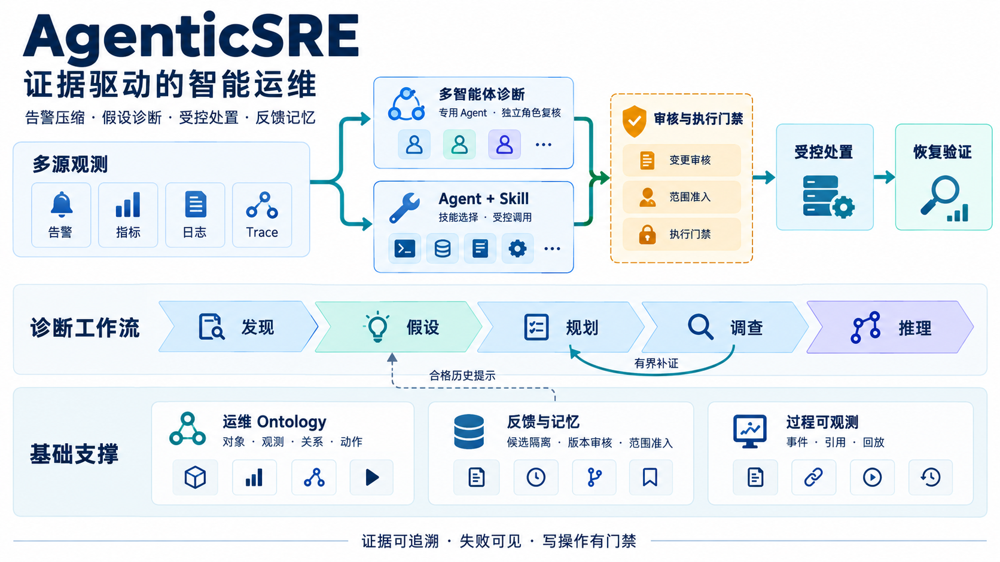

# AgenticSRE — 多智能体协作智能运维系统

> 面向通算与智算的 Agentic SRE：从可追溯证据产生假设，以受控调查完成诊断，通过审核、恢复验证和反馈记忆形成闭环。



这张介绍图由 `imagegen` 生成，概括主要模块与控制关系；具体实现和两条诊断链路的审核边界见下文。

## 项目概述

AgenticSRE 将告警压缩、假设驱动诊断、运维对象建模、受控处置和反馈记忆组织在同一个可审计工作流中。系统同时提供纯多智能体与 Agent+Skill 两条诊断链路，覆盖 Kubernetes 服务、微服务依赖和 vLLM 等被测对象；Web 页面通过 SSE 显示调查阶段、工具事件、观测引用与结果，也可以回放持久化的历史记录。

当前实现强调证据可追溯、失败可见和写操作有门禁。功能实现、离线回归、真实故障注入和诊断准确率是不同的验证层次：测试通过不等于所有故障均能正确诊断，记忆学习也不等于规则自动获得执行资格。

### 核心特性

- 🔍 **主动故障检测**：多维度持续监控（指标/日志/调用链/事件/告警）
- 🧠 **假设驱动RCA**：基于"发现→假设→规划→调查→推理"五阶段范式
- 🧪 **假设与流程审计**：记录候选来源、可反驳条件和观测引用；多智能体由独立角色复核竞争假设，分歧进入有界补证与门禁，详见[诊断策略说明](docs/diagnostic-strategy.md)
- 🤖 **多智能体协作**：专用智能体编排协作，支持链式/反应式/并行模式；多智能体链路不调用 Skill
- 🧩 **Agent+Skill 独立链路**：告警、通算实验、智算实验可选择纯多智能体链路，或通过专用 Agent+Skill 入口调用 Skill 完成检测/诊断/自愈/验证
- 📊 **告警压缩与根因推荐**：保留原文的分组、资源实例隔离、版本化审核与证据包诊断；[能力与边界](docs/alert-compression.md)。效果仍需通过独立样本评估
- 🎯 **可审计置信度**：Raw/Hypothesis/Evidence/Quality/Specificity/History 六因子校准 + 证据不足/冲突动态 cap
- 🔄 **受控记忆演化**：持久反馈收据、候选规则隔离、人工版本审核、范围准入和来源撤销；合格历史规则与事例为调查提供提示
- 👁️ **过程可观测**：结构化阶段事件、工具输入输出、观测引用、审核记录与性能指标；可回放和导出
- 🛠️ **受控修复**：诊断与动作门禁、对象身份和版本核对、ActionStack 回滚保护，以及独立恢复验证

### 系统架构



[Mermaid 源码](diagrams/system-architecture.mmd) · [PNG](diagrams/system-architecture.png) · [可编辑 Excalidraw](diagrams/system-architecture.excalidraw)

架构图按职责组织，连线表示主要调用或数据关系，不表示所有能力均由同一个入口执行：

| 层次 | 职责与代码入口 |
|---|---|
| 交互与触发 | [Web/API](web_app/app.py) 提交和回放调查；[MCP](mcp_server.py) 暴露工具接口；[Daemon](orchestrator/daemon.py) 与 [Pipeline](orchestrator/pipeline.py) 组织检测触发与阶段执行 |
| 纯多智能体诊断 | [RCA Engine](orchestrator/rca_engine.py) 协调专用 Agent、竞争假设、调查计划与独立角色复核；这条链路的工具注册表不包含 Skill Runtime |
| Agent+Skill 诊断 | [SkillAgent](orchestrator/skill_agent.py) 选择技能并经 [Skill Bridge](orchestrator/skill_bridge.py) 调用 [Skill Runtime](skill_runtime/README.md)，运行技能声明的检测、诊断、自愈或验证阶段 |
| 调查上下文 | [Ontology](operational_ontology.py) 保存对象、观测、关系和动作契约；[记忆模块](memory/) 提供有范围、有生命周期的历史知识；轨迹与事件支持过程显示和审核 |
| 工具与执行 | [观测工具](tools/observability.py) 和 [K8s 工具](tools/k8s_tools.py) 访问真实后端；写操作还必须通过对应入口的诊断、权限、审批、风险及目标版本条件，执行后另行验证恢复 |

两条诊断链路共享部分工具、数据契约和存储能力，但不具备完全相同的审核覆盖。多智能体链路已有竞争假设的独立角色复核；Agent+Skill 尚缺等价独立 Judge 时，相关真实对象动作保持阻断。独立角色可以使用同一模型，不能理解为独立模型或已知真值。独立 Skill Runtime 未启动时可使用本进程桥接 fallback，事件会记录实际运行方式，详见 [Agent+Skill 集成](skill_runtime/README.md#agentskill-集成)。

Ontology 借鉴“对象—关系—动作”的组织思想：同一调查中，Pod、Service、控制器等对象以集群、namespace、UID 等身份关联观测；候选假设引用观测，动作引用服务端保存的调查与对象版本。它让页面、诊断和执行使用一致的对象语义，当前仍是**单次调查视图**，尚不是跨调查历史 CMDB，也没有完成外部 Git、镜像注册表和 CI/CD 事实核验。详见 [运维 Ontology 与对象动作](docs/operational-ontology.md)。

## 五阶段 Pipeline

| 阶段 | 名称 | 描述 |
|------|------|------|
| Phase 1 | **DETECTION** | 持续轮询Prometheus告警、K8s事件、ES错误日志、指标异常 |
| Phase 2 | **HYPOTHESIS** | 产生竞争机制假设；合格历史知识只作提示 |
| Phase 3 | **INVESTIGATION** | 规划核验、并行采集、交叉信号关联与假设重排序 |
| Phase 4 | **REASONING** | 综合报告、独立角色复核、置信度校准与有界补证 |
| Phase 5 | **RECOVERY** | 条件触发自愈操作 + 回滚保护 |

这里的五阶段是 Pipeline 的阶段划分；“规划”是调查中的显式步骤，不是额外的第六个 Pipeline 阶段。到达最后阶段不代表已经执行修复或恢复成功。

## 系统工作原理



[Mermaid 源码](diagrams/diagnostic-loop.mmd) · [PNG](diagrams/diagnostic-loop.png) · [可编辑 Excalidraw](diagrams/diagnostic-loop.excalidraw)

上图描述多智能体主链路的控制逻辑；Agent+Skill 的差异见架构说明。实线表示主要处理路径，虚线表示跨次调查的知识提示。恢复结果独立写入恢复历史，不转换为专家反馈标签。

**先固定范围，再整理证据。** 调查记录集群与 namespace；对象 UID、版本等已声明的约束参与身份校验，缺失时不能伪造为已验证。告警压缩保留原文、来源与时间，避免混淆不同实例和集群。观测以稳定 ID 进入目录；缺失、超时和采集失败作为可见状态保存，不能当成“没有异常”。

**假设必须能被区分和反驳。** 模型或确定性种子给出竞争机制，例如 Pending 的资源不足、调度约束与卷等待。每个候选保存来源、支持条件、可反驳条件及本次观测引用。规划阶段根据待判别问题选择工具，采集后更新候选；历史记忆不能冒充当前事故的事实。候选排序分数也不是校准后的根因正确概率。

**流程调整受预算和审核约束。** 独立角色检查候选与最终结论，宿主校验对象范围、引用存在性和输出结构。发现竞争假设或观测缺口时，可在既定次数、来源与时间预算内补证；预算耗尽、模型失败或分歧未解决时，保留原因并转为待复核。当前流程调整依据本次观测缺口及合格历史规则、事例提示；带范围的上下文不会直接载入未隔离的全局执行轨迹。这是有界调查调整，不是任意改写工具、扩大权限、无限循环或已经验证有效的跨事故策略学习。详见 [假设与调查调整](docs/diagnostic-strategy.md)。

**诊断、执行与恢复分别判定。** 最终报告采用六因子校准和动态置信度上限，真实写操作还要通过动作门禁。当前对象动作适配器对受支持的 Deployment 更新使用 UID/resourceVersion 条件补丁；不能编译的操作拒绝执行。动作超时或效果不明记为 `outcome_unknown`，不能记为成功或自动重试。恢复由基础设施及业务探针另行验证，恢复成功不能反向证明根因正确。

**反馈进入受控记忆，而不是直接变成规则。** 反馈绑定事故并保存提交时的诊断快照；调用者提供诊断版本时核对一致性，显式规则投票还必须匹配对应 revision。持久收据保证重试不会重复消费。自动学习结果先进入候选区，人工审核的内容版本才有启用资格；编辑后重新待审，来源撤销会阻断相关规则的后续使用。读取历史先检查集群、namespace、已声明的 UID/版本约束及时间适用性，再进行 top-k 排序。详见 [反馈契约](docs/feedback-contract.md)、[候选审核](docs/memory-candidates.md)、[记忆准入](docs/memory-admission.md) 和 [反馈撤销](docs/feedback-retraction.md)。

### 当前验证边界

已完成的 [Train Ticket 实际故障注入](docs/validation/train-ticket-business-injection-20261023.md) 包含查询链上的有效网络延迟与丢包实验，分别记录健康基线、业务影响和连续恢复窗口，也保留业务未受明显影响的失败注入。它们验证了限定查询链的故障效果与恢复，**不代表完整预订交易或自动根因诊断已经验收**。当次真实模型服务返回 HTTP 402，诊断准确性仍未验证；根因推荐准确率及记忆带来的准确率提升仍需独立样本和冻结基线评估。

## RCA 置信度校准

AgenticSRE 不直接使用大模型自报的 confidence，而是将其作为 Raw 先验，再结合假设分支稳定性、多源证据、Judge/Critic 质量评审、根因具体性和可准入的历史诊断标签进行六因子校准。历史标签的来源与独立性需要单独审计。恢复是否成功不参与 RCA 置信度，它只用于判断某个恢复动作能否自动执行：

```text
Cweighted = 0.18×Raw + 0.18×Hypothesis + 0.27×Evidence
          + 0.17×Quality + 0.10×Specificity + 0.10×History

Cfinal = min(Cweighted, DynamicCap)
```

上述为默认参数。权重、Evidence 子权重、历史样本门槛和各类 cap 已可在 `configs/config.yaml > confidence_calibration` 中调整。运行时会校验并自动归一化权重，实际使用的配置、因子贡献和 cap 触发条件会写入 `confidence_explanation`。修改 YAML 后需重启服务或重新加载配置。

### 大模型与规则/统计的责任边界

| 因子 | 权重 | 分类 | 分数来源与计算方式 |
|---|---:|---|---|
| Raw | 18% | **大模型为主** | 大模型在最终 RCA JSON 中给出校准前 `confidence`；最终报告不可用、JSON 无效或根因为空时弃答，降级初始值为 `0`，保留观测并要求人工复核 |
| Hypothesis | 18% | **大模型 + 规则** | 通用场景由大模型生成和重排假设 confidence；部分高信号 K8s 场景使用脚本预置分；最终因子由 Top1 和 Top1-Top2 margin 规则计算 |
| Evidence | 27% | **规则评分，输入混合** | Prometheus、日志、Trace、K8s Event 等是实际观测，Agent 文本摘要可由大模型生成；因子分由证据源数、严重度和结论对齐度规则计算 |
| Quality | 17% | **大模型 + 规则** | RCAJudge 融合语言/长度规则与 LLM Judge；Critic 正常由大模型评分，失败时使用启发式规则；脚本再按 `65% Judge + 35% Critic` 融合 |
| Specificity | 10% | **规则脚本** | 大模型只提供 `root_cause`、`fault_type`、`affected_services` 等被检查字段，分数由字段完整性、长度和模糊表达规则计算 |
| History | 10% | **历史标签统计** | 计算因子时不调用模型；统计可准入且未撤销的明确 `correct` 标签，样本充足时取标签比例的 Clopper–Pearson 单侧下界，否则使用中性值 `0.5`。标签可能来自模型对照专家文本，不等于独立真值 |
| DynamicCap | — | **可配置规则** | 对证据不足、反证、人工复核和低历史诊断正确率设置硬上限，大模型无法绕过 |

严格地说，大模型直接产生的是 Raw、假设候选 confidence、LLM Judge level 和 Critic quality score；Hypothesis 因子转换、Evidence/Specificity/History 因子分、Quality 融合、六因子加权与 DynamicCap 全部由确定性代码执行。

### 六因子内部计算

1. **Raw**：取六因子校准前 confidence。它通常来自大模型最终 RCA 报告，但 Critic 可能在校准前要求改写报告或调整该值，因此 Raw 不一定是模型第一次输出的分数。

2. **Hypothesis**：脚本根据候选假设排序计算：

   ```text
   margin = max(0, Top1 - Top2)
   Hypothesis = 0.75×Top1 + 0.25×min(1, 2×margin)
   ```

   Top1 高表示最佳假设自身较强，margin 大表示与备选假设区分明显；多个假设分数接近时会降低分支确定性。

3. **Evidence**：不让大模型直接给 Evidence 因子分，而由脚本计算：

   ```text
   coverage  = min(1, 成功证据条目数 / 4)
   signal    = min(1, 结构化证据严重度总分 / 3)
   alignment = min(1, RCA结论与证据关键词命中数 / 5)

   Evidence = 0.45×coverage + 0.35×signal + 0.20×alignment
   ```

   严重度权重为 `critical=1.0`、`error=0.9`、`warning=0.65`、`info=0.35`。当前“独立证据源”是工程上的 Agent/观测通道数，不代表统计意义上完全独立的样本。

4. **Quality**：

   ```text
   Quality = 0.65×JudgeScore + 0.35×CriticScore
   ```

   RCAJudge 默认使用 `60% RuleJudge + 40% LLMJudge`。RuleJudge 检查确定性表达、推理长度和 Raw confidence；LLMJudge 评价逻辑、证据、具体性和可执行性。Critic 正常由大模型输出 `quality_score`，调用失败时使用规则降级。两次模型评审都成功时，Quality 的有效组成约为 `39% RuleJudge + 26% LLMJudge + 35% LLMCritic`。

5. **Specificity**：使用离散规则加分：基础分 `0.25`；根因描述不少于 30 个字符 `+0.25`；`fault_type` 存在且不是 `unknown` `+0.20`；`affected_services` 非空 `+0.15`；不包含“无法确定/证据不足”等模糊表达 `+0.15`，最高为 `1.0`。

6. **History**：按 `fault_type` 或 `error_pattern` 匹配带明确 `correct=true/false` 标签的可用反馈。没有合格标签或样本少于 5 时取中性值 `0.5`；样本不少于 5 时使用标签比例的 95% 单侧 Clopper–Pearson 下界。当前专家文本对照路径标记 `correct_source=model_comparison_to_expert_text`、`independent_truth_verified=false`，不能把该比例作为独立验收准确率。恢复成功、恢复失败、需要改代码或只能人工恢复均不改变这一因子。

### DynamicCap 硬上限

| 触发条件 | 最终置信度上限 |
|---|---:|
| 默认 | 0.95 |
| 成功证据条目不超过 1 个 | 0.72 |
| 没有结构化证据且证据条目少于 3 个 | 0.78 |
| 存在反证 | 0.70 |
| Judge 或 Critic 要求人工复核 | 0.75 |
| Specificity 低于 0.55 | 0.65 |
| 历史诊断标签充分且正确率置信下界不高于 0.30 | 0.65 |

表中数值是默认值，均可在 `confidence_calibration` 配置段中调整。多个条件同时触发时取最低上限。当前输出是可审计的工程置信指数，不直接声明为统计意义上的“根因正确概率”。即使采用统计下界，也只保证对应的二项历史比例估计；它不能证明某一次 RCA 必然正确。

### 诊断历史与恢复历史严格分离

| 历史类型 | 进入 RCA 置信度 | 进入自动恢复门禁 |
|---|---:|---:|
| 合格诊断 `correct` 标签；来源可能为模型对照专家文本 | 是 | 否 |
| 恢复成功/失败、人工恢复、代码修复 | 否 | 是 |

全自动执行默认要求诊断置信度不低于 `0.90`，并且只使用同变更动作指纹和同集群/namespace/目标环境指纹的真实验证恢复结果。默认至少需要 `14` 条成功/失败样本，且恢复成功率的 95% 单侧 Clopper–Pearson 下界不低于 `0.80`；规则还必须显式标记安全，无近期发布变更，动作风险不超过配置上限，且中高风险动作具备回滚操作。dry-run、未验证结果和旧无指纹记录不参与全自动增信；难以安全自动恢复的故障使用 `manual_only` 保留诊断与人工建议，但阻断全自动执行。

完整的审计字段、演示数值复算、代码文件索引和后续优化建议见 [RCA 六因子置信度校准实现说明](docs/confidence_calibration.md)。

## 快速开始

**Docker 一键部署**（推荐，详见 [USER_MANUAL.md](USER_MANUAL.md)）：

```bash
tar xzf agenticsre-release-YYYYMMDD.tar.gz
cd agenticsre-release-YYYYMMDD
cp .env.example .env        # 填 LLM_API_KEY
# 远端部署建议开启 Web 登录:
# AGENTICSRE_AUTH_ENABLED=true
# AGENTICSRE_AUTH_USERNAME=admin
# AGENTICSRE_AUTH_PASSWORD=<change-me>
./deploy_docker.sh
# 浏览器打开 http://<部署机IP>:8080
```

发布包默认加载随包镜像并以 `--no-build` 启动，不会在部署机重新下载 apt/pip 依赖。
只有显式运行 `./deploy_docker.sh --build` 才会在线重建镜像。
开启 `AGENTICSRE_AUTH_ENABLED=true` 后，浏览器会进入 `/login`；`/api/health` 仍保持公开用于容器健康检查，自动化脚本可使用 `AGENTICSRE_AUTH_TOKEN` 配合 `Authorization: Bearer <token>` 调用 API。
必须显式配置登录密码；认证开启但未配密码时，登录返回 `503 auth_password_not_configured`，不会补入默认密码。演示脚本分别从 `AGENTICSRE_AUTH_TOKEN` 和 `AGENTICSRE_DEMO_PASSWORD` 读取调用令牌与登录密码。
如果远端容器不方便重建，也可以写入 `data/auth_config.json` 启用认证，例如：`{"enabled": true, "username": "admin", "password": "change-me", "token": "api-token"}`。

**可选：独立 Skill Runtime 容器**

主 Web 容器已经包含 Agent+Skill fallback，未启动独立 runtime 时仍可运行。生产或演示环境建议同时启动独立 Skill Runtime，便于隔离 Skill 执行、单独健康检查和 Catalog 调试：

```bash
docker compose -f docker-compose.skill-runtime.yaml up -d --no-build
curl -sf http://localhost:8090/api/health
```

默认 `SKILL_RUNTIME_URL=http://127.0.0.1:8090`。如果 Skill Runtime 未启动，Agent+Skill 路径会退回到本地桥接执行，并在 RCA 事件中标记 fallback mode。

**从源码跑**（开发）：

```bash
pip install -r requirements.txt
cp .env.example .env        # 填 LLM_API_KEY
# 配置在 configs/config.yaml & configs/clusters.yaml (字段说明见 configs/README.md)

# Web UI
cd web_app && ./start.sh

# CLI
python main.py daemon
python main.py pipeline "排查服务响应变慢" -n default
python main.py rca "pod CrashLoopBackOff" -n default
```

## 文档地图

| 文档 | 给谁看 |
|---|---|
| [USER_MANUAL.md](USER_MANUAL.md) | **使用者** — 部署、UI 走查、典型工作流、FAQ |
| [configs/README.md](configs/README.md) | **使用者** — 配置字段、LLM provider 切换、多集群 |
| [docs/OFFLINE_DEPLOYMENT.md](docs/OFFLINE_DEPLOYMENT.md) | **交付/运维** — 无网络客户现场的完整容器化一键部署 |
| [docs/OFFLINE_E2E_ACCEPTANCE.md](docs/OFFLINE_E2E_ACCEPTANCE.md) | **验收** — 断网靶机的真实安装、备份恢复与重启结果 |
| [skill_runtime/README.md](skill_runtime/README.md) | **开发/运维** — Skill Runtime、Skill 格式、Agent+Skill 工作流、诊断/自愈闭环 |
| [docs/confidence_calibration.md](docs/confidence_calibration.md) | **AMS/评审/开发** — 六因子置信度、大模型/规则边界、动态 cap 与审计口径 |
| [docs/alert-compression.md](docs/alert-compression.md) | **使用者/开发** — 告警保真、资源实例隔离、编辑与审核恢复的版本契约 |
| [docs/diagnostic-strategy.md](docs/diagnostic-strategy.md) | **使用者/评审/开发** — 假设引用、独立角色复核、有界补证与模型失败弃答 |
| [docs/history-retrieval.md](docs/history-retrieval.md) | **使用者/开发** — 历史读取预算、失败与空结果区分、超时降级 |
| [docs/feedback-contract.md](docs/feedback-contract.md) | **使用者/开发** — 反馈标签、审核准入、持久收据、重试与规则版本投票 |
| [docs/memory-admission.md](docs/memory-admission.md) | **使用者/开发** — 记忆范围与时间准入、检索前过滤、通用规则审核版本及兼容边界 |
| [docs/memory-candidates.md](docs/memory-candidates.md) | **使用者/开发** — 候选隔离、实际新增收据、人工版本审核、编辑后重审与停用历史 |
| [docs/feedback-retraction.md](docs/feedback-retraction.md) | **使用者/开发** — 反馈版本撤销、迟到学习防覆盖、直接来源和规则票据隔离 |
| [docs/operational-ontology.md](docs/operational-ontology.md) | **使用者/开发** — 调查对象、观测、谱系与动作门禁；链接相关调研 |
| [docs/testbeds/README.md](docs/testbeds/README.md) | **测试/部署** — 通算与智算被测对象部署、验收、详细故障类型和恢复边界 |
| [docs/testbeds/precision-fault-injection-status.md](docs/testbeds/precision-fault-injection-status.md) | **故障实验** — 18 个固定适配器，17 个远端 F5 通过、1 个 GPU 容量阻塞；前端集成“细粒度注入”页签 |
| [deploy/k8s-vllm/README.md](deploy/k8s-vllm/README.md) | **智算实验** — K8S vLLM、Prometheus、GPU exporter、负载生成 |
| [docs/integrations/teller_skill_runtime_deployment.md](docs/integrations/teller_skill_runtime_deployment.md) | **集成部署** — TELLER 请求级监控与 Skill 详情弹窗部署验证 |
| [docs/integrations/aishperf_aiops_integration.md](docs/integrations/aishperf_aiops_integration.md) | **集成部署** — AISHPerf/Alcor 场景库和诊断方法接入 |
| [DEVELOPMENT.md](DEVELOPMENT.md) | **开发者** — 模块与开发指南 |
| `RELEASE_NOTES.md` | 生成的离线发布包内提供，不作为源码仓库文件 |

## 验证环境

3节点K8S集群:
```bash
ssh -J "${AGENTICSRE_DEPLOY_JUMP_HOST}" "${AGENTICSRE_DEPLOY_TARGET}"
```

## 项目结构

```
AgenticSRE/
├── main.py                  # 主入口
├── mcp_server.py            # MCP Server (Claude/Copilot集成)
├── diagnostic_strategy.py   # 有引用的假设与有界调查决策
├── operational_ontology.py  # 调查对象、观测与动作契约
├── operational_lineage.py   # UID 核对的控制器与镜像追溯
├── operational_provenance.py # 来源声明与快照比较
├── requirements.txt         # Python依赖
├── configs/                 # 配置文件
├── agents/                  # 智能体模块
│   ├── alert_agent.py       # 告警压缩与根因推荐
│   ├── metric_agent.py      # 指标分析
│   ├── log_agent.py         # 日志分析
│   ├── trace_agent.py       # 调用链分析
│   ├── event_agent.py       # K8s事件分析
│   ├── hypothesis_agent.py  # 假设生成与重排序
│   ├── correlation_agent.py # 交叉信号关联
│   ├── detection_agent.py   # 持续异常检测
│   ├── planning_agent.py    # 规划智能体
│   ├── remediation_agent.py # 自愈智能体
│   └── profiling_agent.py   # Profiling分析
├── tools/                   # 工具层
│   ├── base_tool.py         # 工具基类 + 注册器
│   ├── k8s_tools.py         # K8s操作工具
│   ├── k8s_ops.py           # K8s SDK原生操作
│   ├── observability.py     # Prometheus/ES/Jaeger
│   ├── anomaly_detection.py # 异常检测算法
│   ├── hero_analysis.py     # Hero分析引擎
│   ├── rca_localization.py  # 图推理RCA
│   ├── action_stack.py      # 操作回滚栈
│   └── llm_client.py        # LLM客户端
├── memory/                  # 记忆与演化
│   ├── fault_context_store.py  # 故障上下文存储
│   ├── history_retrieval.py    # 有界历史读取与状态快照
│   ├── context_learner.py      # 自动规则学习
│   ├── rca_judge.py            # RCA质量评估
│   └── trace_store.py          # 执行轨迹存储
├── orchestrator/            # 编排层
│   ├── rca_engine.py        # 核心RCA引擎
│   ├── pipeline.py          # 五阶段Pipeline
│   ├── daemon.py            # 7×24守护进程
│   ├── skill_bridge.py      # Agent 调用 Skill Runtime 的桥接层
│   └── session.py           # 会话状态管理
├── skill_runtime/           # Skill Runtime 与 SKILL.md/skill.py 技能目录
│   ├── app.py               # 独立 Skill Runtime API
│   ├── workflow.py          # detect/diagnose/heal/verify 编排与主 Skill 选择
│   └── skills/              # K8s、LLM、DB、工具类 Skills
├── observability/           # 智能体可观测性
│   ├── tracer.py            # 执行追踪器
│   ├── metrics_collector.py # 性能指标收集
│   └── validator.py         # 行为验证器
├── web_app/                 # Web Dashboard
│   ├── app.py               # FastAPI后端
│   ├── templates/           # Jinja2模板
│   └── static/              # 前端资源
└── eval/                    # 评估模块
    ├── benchmark_runner.py  # 基准测试运行器
    └── eval_tasks.yaml      # 测试任务定义
```

## 版本与验证

最近已上线的 2026-10-22 版本见[发布核验](docs/validation/agentic-sre-release-20261022.md)，不等同于当前 GitHub 源码快照。最近一次远端离线全量回归 **2,023 项通过**，后续图文与展示措辞更新另做静态核验；这些结果不能替代真实模型诊断准确率或记忆收益验收。
