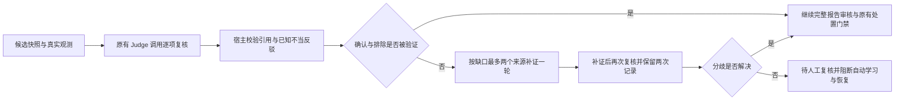

# 假设生成与诊断流程调整

当前实现把初始候选、真实观测、模型修订和宿主调查决策分别保存。入口是告警“分析”中的多智能体诊断或 Agent+Skill 诊断；打开历史记录后，可在结果区的“假设产生与调查调整”查看初始候选、逐轮评分、支持/反驳引用、待判别问题、实际采集来源和停止原因。展开轮次后，点击 `obs-…` 按钮可定位本次调查的原始观测。

## 生成与修订

通用事故由模型生成候选；部分 Kubernetes 症状使用确定性初始候选。来源记录为 `llm`、`llm_with_history` 或 `deterministic_seed`，模型生成失败另作标记。历史规则可提示候选，但不能作为当前事故的观测。Pending 场景将资源不足、调度约束和存储等待拆为可区分机制，并写明支持与反驳条件。候选分数是排序建议，不是校准后的正确概率。

多智能体主诊断入口使用严格引用模式。候选升降、确认或排除必须引用本次已保存、当前范围内的结构化观测；摘要不能冒充事实。目录与 Ontology 共用同一个观测 ID。伪造引用、重复候选更新、同一观测同时支持和反驳、非有限或越界分数都保留为校验缺口，不能推动提前停止。新增机制分支必须有实际支持引用和已观测对象，数量受上限限制；新分支先作为待验证候选。

引用能解析，仅证明记录存在。它不证明观测在逻辑上支持该机制，也不证明因果。最终独立 Judge、模型响应完整性、置信度校准、人工审核与执行审批继续生效。

## 竞争假设的独立角色复核

多智能体链路现在把候选快照与同一范围内的观测目录交给已有 Judge，在原有的一次质量复核调用中逐项返回 `supported`、`contradicted` 或 `uncertain`，并引用 `obs-…` ID。总体报告的审核继续使用原有 E 编号，两类引用不能混用。复核要求检查具体机制、对象、namespace、UID 实例、时间及因果方向，不能把“没提及某机制”当作反证。

宿主校验候选 ID、重复/遗漏项、状态、理由与引用结构，分别保存提出角色状态和复核判断。`confirmed` 需要复核支持，`rejected` 需要复核给出直接反证；缺失、矛盾、格式无效或不确定的复核不能验证这些确认/排除判断。提出角色的旧校验缺口也不能被覆盖。未解决的断言会将质量评分降为 0 并标记 `asserted_hypothesis_not_independently_verified`，因此原有自动学习与恢复门禁保持阻断。仍为 `active` 的候选允许不确定，不会因此变成已确认根因；最终结论另受完整报告审核约束。

复核不同意确认/排除时，诊断闭环优先使用其具体缺失观测与可用 Agent 建议，最多选择两个来源、执行原有的一轮补证，再调用原有闭环复核。提出角色满足提前停止条件或 Critic 超时，不能吞掉这种分歧；总模型时间预算、采集超时和未解决时转人工的条件保持生效。新增逻辑没有逐假设另开模型调用，但发生分歧时可能触发原有补证与再次复核，不能宣称整体调用数始终不变。

这是独立角色复核，可以使用同一个模型，不等于独立模型、人工真值或逻辑证明。机制是否被观测支持仍是可出错的模型判断；确定性检查负责确保该判断没有伪造引用或混淆角色。Agent+Skill 尚未接入等价独立 Judge，页面明确展示这个缺口，不生成虚假复核。

真实验收曾发现复核模型以“事件未提及卷问题、间接反驳卷机制”为理由排除卷候选。宿主现在对这类明确依赖未提及、缺少证据或间接理由的反驳保守弃答：保留 `reviewer_status=contradicted` 原判断与原文，合格判断降为 `uncertain`，写入 `rationale_limits` 并阻断未验证的排除。页面同时显示原模型判断与宿主限制。该规则只识别已知的明确理由模式，不是完整的语义正确性分类器；措辞没有触发规则也不能证明推理正确。

## 用完整声明进行限定的可证伪检查

EventAgent 复用已有的完整 Pod JSON 读取，额外保存 `pod_spec_checks` 观测；不增加一次工具读取。投影绑定 namespace、Pod 名、UID、资源版本和采集时间，仅保留卷名称/类型及 CPU/memory requests，不保存 env、注解内容、Secret 名称或 projected 内容。缺少 UID/版本、删除中的对象及不完整结构不能提供这类确认依据。

Pending 初始候选现在区分两项宿主指定的检查：

| `verification_test` | 值为 true 的含义 | 能反驳的限定候选 |
| --- | --- | --- |
| `zero_cpu_memory_requests` | 未调度 Pending Pod 的所有普通/init/ephemeral 容器、Pod 级和 overhead CPU/memory requests 均为零 | CPU/memory 请求超过节点可分配量；不涉及 GPU、Pod 数、节点压力或其他资源 |
| `no_pvc_or_ephemeral_volume` | 完整声明无卷，或仅含 projected/secret/configMap/downwardAPI/emptyDir，无 PVC 或通用临时卷引用 | 等待 PVC/通用临时卷绑定；不表示所有存储均健康 |

非零请求或存在 PVC 仅表示上述排除条件不成立，不确认资源不足或卷未绑定。未知卷类型、CSI/hostPath、resize/已分配资源状态、非法数量、过大的列表等按相应检查保留 unknown，而非从缺少字段猜结论。只检查“所有相关请求均为零”，避免把 init/sidecar/Pod overhead 的调度语义简化为普通容器相加。请求与调度依据见 [Kubernetes 资源管理](https://kubernetes.io/docs/concepts/configuration/manage-resources-containers/)和 [Pod Overhead](https://kubernetes.io/docs/concepts/scheduling-eviction/pod-overhead/)；卷类型见 [Kubernetes Volumes](https://kubernetes.io/docs/concepts/storage/volumes/)。这些文档支持字段语义，本项目的保守检查边界由代码与测试定义。

对带有上述宿主检查的候选，模型排除必须引用检查结果为 true 的真实观测；警告事件、摘要、另一机制成立或 false/null 检查值都不够。明确的类型化反证已经存在时，生成和复核角色也不能选择性引用另一条普通观测来确认该候选。只有对象范围能唯一绑定一个 Pod UID 时才应用检查，不能借用另一 Pod 或重建实例的声明。`verified_test_evidence_ids` 和 `host_test_evidence_ids` 均可在页面点击回查。

## 补证后的对象身份契约

单 Pod 诊断在首次质量复核前，从直接 Pod JSON 观测核对明确选择的对象，并补入实际 UID。没有从根因文字或受影响列表猜选对象。补证后再次核对；有 EventAgent 补证结果时，以该次结果为依据，不能用旧观测掩盖采集失败或同名重建。

补证输出约定包含 `root_entity`。若模型漏掉此字段，且原整份报告仍能绑定同一实际 UID，系统拒绝整份不完整改写、保留原报告，再让 Judge 结合补证审核；不会把旧身份拼到新的根因文字上。模型明确返回 null 时尊重弃答，不恢复旧身份。同名不同 UID、多个实例、缺失或失败观测无法建立绑定时，保留缺口，并通过 `root_entity_not_uid_bound` 阻断自动学习与恢复。

UID 绑定只验证调查记录中的对象身份，不证明根因，也不是执行时实时取证。资源版本按不透明值保存；多个版本不会强行选作一个执行条件。已有对象动作在执行前仍要求自己的 UID/版本、预演和审批门禁。本阶段新增绑定仅覆盖单 Pod 生命周期诊断，不是通用 CMDB 身份推断。

## 当前事故内的调查调整

规划输入包括前两名未排除候选、前轮决策、尝试次数、采集失败和待判别问题。宿主控制器根据可用来源和候选建议选择尚未尝试的来源，保留已有 Kubernetes 生命周期与传播调查的必要采集通道。模型规划中的命令仍受现有工具实现约束，不直接变成任意执行授权。

逐来源状态现在跨轮保存为 `source_states`：`untried`、`failed`、`observed` 或 `no_citable_observations`，分别表示尚未尝试、失败/部分失败/结果未知、已取得当前范围可引用观测、采集完成但没有当前范围可引用观测。每个来源保存实际尝试次数、最近尝试轮次、最多八个最近观测 ID 及当前重试资格，不保存原始错误文本。只有实际选择的来源能更新其状态；检查其他来源不会抹去旧失败，未选择来源的返回项也不能伪造一次尝试。

控制器优先接受前两个活动候选对“未尝试来源”或“仍有重试额度的失败来源”的建议，然后检查其他未尝试来源及仍可重试的失败来源，每轮最多建议两个。自动失败重试最多一次（连同首次共两次），成功但没有可引用数据不会自动按暂时故障反复重试。恢复成功后状态替换为本次真实结果；仍失败但额度用完时保留取证缺口。`decision.next_agent_reasons` 保存实际下一来源的选择理由，`feedback.unresolved_collection_failures` 将跨轮未解决失败放在有界规划摘要前部；完整状态随每轮审计保存。来源状态、评分和重试资格都不是正反证，也不能授权执行。

该上限只约束控制器安排的失败重试；既有生命周期和传播链路的必要核查保留原流程约束，因此不能宣称任何来源在整个诊断中总共只调用两次。所有调用继续受总轮数、工具超时和模型预算限制。页面“取证来源状态与重试”显示上述实际状态和选择理由；旧轮次没有保存该字段时明确标注不能倒推，不补造历史状态。最小反例、实际引擎三轮恢复测试和真实告警验收见[跨轮重试验收](../outputs/retry-final-20261020/verification.md)。

冷启动验收还发现，空规则库和空事故库调用向量查询也会触发嵌入模型下载。历史检索先读取对应集合的 count，明确为空时直接返回空上下文，避免没有候选记录可返回时仍下载模型；非空集合继续实际向量检索。后续补充了[历史读取等待预算与状态](history-retrieval.md)：初始化和向量读取超过预算时继续实时诊断，区分失败与合法空结果，超时结果不能回填本次快照。空历史记忆不是当前事故的反证，计数/检索失败也不能推动假设确认；该机制不等于底层下载已被取消或所有上下文 I/O 均有截止时间。

有效的前轮来源在后轮仍可引用。失败来源不会提供本轮的正向停止依据；采集失败也不自动成为反证。语义指纹忽略采集时间和 `resourceVersion` 变化，保留真实对象身份与观测内容；没有新增差异观测时跳过重复模型重排。这个指纹是工程去重机制，不是统计独立性检验或信息论熵。

调查由原有最大轮数和模型时间预算约束。满足“有可解析引用、没有反驳或校验缺口”的候选可转入独立审核；没有新信息且没有其他来源、预算耗尽或达到轮数上限时也会停止。停止不代表已确认根因。既有诊断闭环复核可另行补证，其过程在闭环阶段显示，不计为假设调查轮次。

Agent+Skill 复用已有专项 Skill 的一次实际执行和已有裁决响应，增加候选引用审计。结构化工具结果与 Ontology 使用同一投影，失败或执行结果未知的工具不能生成正向引用。专项模式仍为单轮取证，`adaptive_skill_replanning_enabled=false`，没有增加隐式模型或工具调用；它不等同于多智能体的有界重规划，也不凭此新增独立 Judge。

## API 与持久化

历史分析现在支持搜索和继续加载较早记录。进入“高级工具 → 独立根因分析 → 历史分析”，按运行 ID、故障描述、命名空间或集群进行字面量、不区分大小写的搜索；点击记录或用 Enter/空格打开已有工作流。打开详情保留已展开、已筛选的列表；列表刷新与顶栏手动刷新会按当前搜索重新获取第一页，新诊断完成时也会刷新。加载失败保留此前结果并显示重试入口；搜索和翻页请求使用独立的请求代次，延迟返回不能混入新搜索结果。

`GET /api/rca/history` 保留原 `runs` 摘要结构，新增 `q`、`cursor` 和有界 `limit`（默认 20，1–100）。返回 `total`（当前匹配数）、`retained_total`（当前服务保留数）、`has_more`、`next_cursor`；搜索不读取详细日志或证据正文。后续页携带原搜索和 `next_cursor`，按 `(started_at, id)` 严格向前翻页，时间相同时仍确定排序；新诊断插到顶部不会导致偏移分页式重复。游标只表达列表边界，不能授权额外访问，也不是不可变快照；查询范围改变、记录内容改变或保留集变化时应刷新。无效或与搜索不符的游标返回 400，越界参数返回 422；响应设置 `Cache-Control: private, no-store`。

页面明确搜索范围是服务当前保留的记录。持久化规则仍为进行中的诊断及最近 200 条已结束诊断；本轮没有扩展存储保留期，也不恢复已经淘汰的历史。历史检索和打开详情只读，不启动模型或采集，不会重跑诊断。行为回归、34 条真实保留记录的页面导航及重启检验见[历史检索验收](../outputs/history-20261020/verification.md)。

`GET /api/rca/{run_id}/strategy` 返回 `generation`、`rounds`、`independent_reviews`、`stop_reason`、`revision` 和能力语义。每轮包含修订前后候选、观测目录、差异/重复观测、实际 Agent、原始计划、采集失败、分支接受/拒绝理由和下一步决策。`independent_reviews` 追加保存初次与补证后的提出角色状态、复核判断、实际引用及校验缺口；不会改写旧轮次。此接口遵循现有访问控制，只读取快照，不触发模型、采集或新诊断。不存在的记录返回 404。

报告 JSON 的 `diagnostic_strategy` 与该接口一致，HTML 导出保留过程。旧诊断没有保存新格式时返回 `legacy_or_not_yet_recorded`；页面明确说明不能从最终结论倒推过程。运行中与失败的诊断可以通过已保存事件回放部分过程。重启后的过程完整性以验收记录为准。

## 能力边界与验证

### 补证缺口与停止条件

后续工作增加 `investigation-readiness/v1` 逐轮记录，检查主候选的未解决问题、具有当前有效引用且评分接近的其他候选、主候选仍请求的失败来源。候选评分差不超过 0.10 时保守保留区分任务；这是工程启发式，不是校准概率，也不假定两个机制必然互斥。被排除、引用无效、存在反驳或评分明显较低的分支不触发该条件。

缺口存在时，在原轮数、来源重试和模型预算内安排来源切换。失败来源的可重试额度用尽不会自动消除取证缺口；没有可继续来源时停止并保留缺口。规划反馈把缺口放在前部，避免被有界上下文截断。过程页面展示本轮条件和待判别问题，旧轮次明确说明未保存，报告沿用已记录策略。

模型更新缺少 `unresolved_questions` 或 `next_agents` 时保留原值；字段类型错误、引用错误、评分或状态校验失败时不提交清空操作。有效且有引用的更新可以显式用空列表清空。清空仍是模型评估结果，后续独立审核保留，并不构成宿主对因果已经成立的证明。

若最后一轮仍保留这些具体缺口，最终门禁要求人工复核，置信度上限为 0.65，阻断自动学习和恢复。补充闭环中的新增原始观测或模型高分不能单独证明该问题已经解决；目前采取保守处理，尚未增加逐问题关闭的闭环判定。该机制仍是单次事故内的有界补证，不是跨事故策略训练。

本节已完成远端专项 34 项、相关 180 项、全量 1814 项回归，并在隔离镜像中验证两种实际引擎受控案例的页面展示。四个真实集群诊断样本中，调度两种模式和镜像 Skill 通过；镜像多智能体在三轮补证后遭遇模型服务 HTTP 402，未通过真实诊断验收。不能据此声称所有诊断均正确或模型审核完整。原失败记录保留，后续新增模型异常降级验收，详见[阶段记录](../outputs/investigation-readiness-20261020/verification-pending.md)。

当前“流程自优化”指单次事故内由外部观测反馈驱动的有界来源调整。跨事故全局策略训练、自动策略晋升以及准确率/成本优势尚未通过固定样本对照验证；不会把模型自评反复写入学习闭环作为正确性证明。当前研究依据、竞争方案与证伪条件见[研究记录](research/hypothesis-adaptation-20261020.md)。

行为回归见 `tests/test_diagnostic_strategy.py`、`tests/test_hypothesis_independent_review.py` 及 `tests/test_typed_pod_verification.py`。完整声明和补证身份的复现及验收在 `outputs/predicate-20261020/verification.md`；前两阶段分别在 `outputs/adaptive-20261020/verification.md` 和 `outputs/hypreview-20261020/verification.md`。

## 模型调用失败与报告弃答

多智能体的 `DeadlineLLMClient` 将 SDK 调用失败记录为脱敏 `failed_calls`，仅含固定错误分类和 HTTP 状态码，不把外部异常正文传给会持久化的调用方。最近记录最多 16 项，累计次数另存。401/402/403/404 触发本次诊断会话的快速拒绝，避免继续发送相同配置下的请求；429/500/503 允许后续调用尝试，但早先失败记录仍参与最终完整性门禁。这是会话内保守策略，不是平台级熔断或服务健康监控，也未扩展到所有普通 `LLMClient` 工作流。

调用失败与时间预算分开：模型拒绝不把剩余预算写成零，也不伪装成超时。失败调用、超时、响应截断和最终报告结构错误任一存在时，后续高分 Judge 不能抹去未完成状态，最终要求人工复核，阻断自动学习和恢复。

最终报告不可用时，不把排名第一候选的描述升级为根因。仅在请求明确包含唯一 Pod 名和命名空间时保留 `incident_target`，标注根因未完成模型核验，降级初始置信度为 0、`root_entity=null`；后续仍经六因子校准，模型完整性门禁将最终置信度限制在 0.65 以内并阻断自动学习和恢复。其他观测和候选留在过程记录。该目标来自用户调查范围，不是已证实的因果对象。报告阶段持久化 `status=degraded`，页面显示“未完成”，旧事件未记录此字段时沿用原回放语义，不能为旧失败样本补造新状态。

实现与受控异常回归见 `tests/test_model_provider_failure.py`；本轮远端全量、真实模型服务及页面验证状态以[本次发布核验](validation/agentic-sre-release-20261022.md)为准。实际服务 HTTP 402 尚未恢复时，受控回归只证明降级逻辑，不计作正常模型诊断成功。
