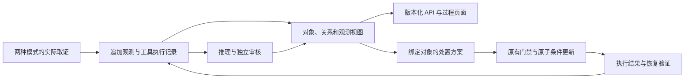

# 运维对象模型与对象动作

本模块借鉴 Palantir Operational Ontology 的对象、逻辑、动作和约束组织方式，结合 UModel 的运维实体与观测关联。它是项目内部的数据契约，没有连接或依赖 Palantir、STAROps 的商业服务。来源、竞争方案与后续阶段见[调研记录](research/agentic-sre-ontology-20261020.md)。

## 当前实现

图中的恢复验证是单独观测；一次动作执行成功不能直接推导业务恢复。

`operational_ontology.py` 将同一次调查中的对象、观测、事实关系、审核引用和工具执行投影为版本化视图。对象身份使用 cluster、namespace、kind、name、UID；UID 未知的对象与 UID 已知的实例不自动合并。同名重建对象分别保留，不能直接选作动作目标。schema 表示支持的类型，不表示实际已采集到相应对象。

多智能体的每次取证通过 `RCASession.record_evidence` 追加保存，并以 `observation_batch` 事件即时进入现有持久化路径。后续结果或错误不会抹去前轮观测；当前推理字典仍代表最近结果。Agent+Skill 使用已提交的真实工具结果，只有已确认执行成功的结构化 Kubernetes 数据才能生成对象观测；文本摘要、失败和未知结果不能冒充资源事实。工具结果投影不复制 env、Secret 或 last-applied annotation 内容。

Agent 的证据格式化和确定性根因范围校验共享同一身份解析。镜像拉取专项 Skill 在同一次 Kubernetes 读取中投影 Pod 名称、namespace、UID、资源版本、节点归属与容器状态，避免状态数据失去所属实例；缺失或冲突身份不能伪造绑定。指标保留实际标签、查询语句、样本、单位和结果类型。采集时间、事件时间、样本时间分别记录；`resourceVersion` 原样保留并用于一致性条件，本模型不据此推断跨对象时间顺序。关系仅从显式 `ownerReferences`、`nodeName` 等结构化字段产生，每条关系保留观测引用；关系不证明因果。

已有旧记录可以读取审核节选或历史事件，但会标出节选和数据缺口，不能补造从未保存的原始证据。审核的 E 编号可回查统一观测 ID；匹配失败时显示未解析，不自行生成支持关系。

## 接口与页面

| 接口 | 用途 |
| --- | --- |
| `GET /api/ontology/schema` | 对象、关系、动作定义及约束 |
| `GET /api/rca/{run_id}/ontology` | 调查版本、范围、数量、缺口、判断与动作前置条件 |
| `GET /api/rca/{run_id}/ontology/{collection}` | 分页读取 objects、observations、relations、tool_executions |
| `GET /api/rca/{run_id}/lineage` | 读取已保存的补充追溯，不访问集群 |
| `POST /api/rca/{run_id}/lineage` | 对已记录的 UID 对象执行有界只读追溯；body 为 `entity_id`、`revision` |
| `GET /api/rca/{run_id}/lineage/compare` | 只比较当前调查保存的两份快照，参数 `before_id`、`after_id` |

集合读取支持 `entity_id`、`record_id`、`offset`、`limit`（1–100）和 `revision`。指定旧 revision 返回 409，避免将不同调查版本拼接。页面切换与分页响应都绑定 run 和请求代次，旧响应不能覆盖新记录。诊断结果页提供对象、观测、关系、工具状态、审核引用跳转；这些读取不会启动新诊断或调用模型。JSON 报告包含相同版本的对象与关联信息，完整观测经分页接口读取。

## 对象动作

RCA 页面生成方案时携带服务端 run 与 ontology revision。服务端从已保存诊断重新取得结论、对象和范围，不接受调用者替换诊断结论。动作目标必须具有唯一的 UID 和资源版本，并满足原有独立审核、诊断、配置、审批与风险条件。

真实执行还需要先生成服务端 Dry-run 记录。命令、回退命令、run、对象和调查版本必须与该记录一致。修改动作内容必须重新预演；目前每个对象动作执行请求仅接受一个操作。预演只记录计划，不声称已经执行 Kubernetes 服务端 dry-run 或验证恢复。

支持的写适配器为 Deployment 的 scale、restart、set_image。适配器把命令转为一次 Kubernetes JSON Patch，先 test UID 和 resourceVersion，再更改具体字段，避免先 GET 后按名称写入的替换竞态。执行路径只调整可执行 argv 与集群参数，不修改补丁或镜像字符串。不能编译的写操作拒绝执行，不回退到任意 shell；StatefulSet 尚未启用写适配器。

分发前以持久化 claim 消费方案，并用方案锁防重复提交。超时、异常或不能确认的副作用为 `outcome_unknown`：`success` 和 `recovered` 保持空值，不进入恢复成功/失败统计，也不自动重试。服务中断留下的 claim 同样需要核查。回退必须针对最新对象重新取证并生成独立方案，不能重放旧版本命令。

单次 JSON Patch 仅保证该 Kubernetes 对象更新的原子性，不提供跨命令、跨对象或业务系统的分布式事务。条件更新依据见 [Kubernetes API Concepts](https://kubernetes.io/docs/reference/using-api/api-concepts/#choosing-an-update-mechanism)。现有恢复验证仍单独判断基础设施及业务恢复。当前候选保持仅建议配置，真实写适配器的实现与测试不能替代生产处置验收。

## 明确的覆盖边界

本轮迁移了 RCA 页面发起的关联 run 动作。旧手工/告警入口继续使用既有规则，尚未全部转换为对象动作。当前模型是单次调查的观测视图，尚不是跨调查历史 CMDB。补充追溯已支持控制器归属、控制器修订号、声明镜像和运行时 `imageID`；Git、CI/CD 发布事件、负责人和完整版本历史仍未接入。Agent+Skill 缺少等价独立 Judge 时会如实阻断真实对象动作。

后续阶段应扩展跨域事实适配器、对象权限与审批身份、类型化后置条件和回退、固定故障集的对照评估。当前测试通过不能证明全故障准确率或生产自治能力。

## 诊断后的发布与镜像追溯

对象详情的“采集发布与镜像追溯”适用于当前调查范围内、具有真实 UID 的 Pod、ReplicaSet、Deployment、StatefulSet、DaemonSet、Job 和 CronJob。请求必须携带原调查版本；服务端只接受模型中的对象 ID，不接受调用者指定 shell、集群或另一个对象名称。无 UID 的旧指标对象不能直接进入这条路径。

`operational_lineage.py` 每次最多读取六个对象，每次查询超时十秒。它沿唯一的 `controller=true` ownerReference 遍历，每一级核对返回 kind、name、namespace、UID 和 resourceVersion；上级被同名重建、无法读取、引用循环或类型不支持时保留已核对观测并显式标为部分可用。只有两端均读到且 UID 匹配才产出 `controlled_by` 关系。独立 Pod 缺少控制器时不会生成 Deployment 或发布关系。

投影只保存身份、ownerReferences、创建时间、`deployment.kubernetes.io/revision`、三类容器镜像字段及受控来源声明，不保存 env、其余任意注解或完整 YAML。Pod 的 spec 镜像引用与 status 的运行时 imageID 分开存储，按容器名称及 application/init/ephemeral 类别匹配；缺失 imageID 不根据 tag 或模板补出。运行时标识按原文保留，不把所有运行时格式等同于注册表 manifest digest。各资源在不同时间读取，不提供跨对象一致性快照。

每份快照包含独立 ID、原 run/revision、采集时间、关系来源观测 ID 与明确缺口。新快照追加到 `lineage_snapshots`，每次调查最多二十份，并发采集返回 409，持久化失败返回 503。它们作为 `supplemental_lineage` 进入 JSON、前端报告预览和 HTML 导出；原 `observations`、Judge 结论和 Ontology revision 不变，页面明确显示原 Judge 没有审核这些补充数据。GET、刷新与历史回放只读取持久化快照。

控制器修订号不等于 Git 提交，资源创建时间不等于发布时间，归属和镜像关联不能单独证明发布导致故障。上述边界分别依据 [Kubernetes owner references](https://kubernetes.io/docs/concepts/overview/working-with-objects/owners-dependents/)、[Deployment revision](https://kubernetes.io/docs/concepts/workloads/controllers/deployment/#rolling-back-a-deployment) 和 [镜像引用与 digest](https://kubernetes.io/docs/concepts/containers/images/)。这些是实现契约，不是全场景准确率结论。

## 来源声明与快照比较

`operational_provenance.py` 从资源及 Pod 模板元数据中读取受控的 OCI source/revision/version/created、应用版本、Helm release、Argo CD/Flux 管理标记。值保留精确来源路径；资源级 source 与模板级 revision 不会拼成一个代码映射。同一位置的 source/revision 配对也只形成 `declared_unverified` 候选，完整十六进制 revision 仅表示格式，不代表 Git 提交真实存在或已与运行镜像绑定。不同位置的冲突声明各自保留。

受支持的 source 地址只接受 HTTPS，并拒绝用户信息、查询参数、fragment、控制字符和不支持的地址格式；不合格项只保存字段名及省略原因，不保存原值。声明仅显示文本，采集与比较均不访问这些地址。GitOps 管理标签不是控制器资源存在、同步成功或发布完成的证明，不会因此生成已验证的 Git/CD 事实边。当前集群默认命名空间的十二个 Deployment 没有这些来源字段，也未发现 Argo CD/Flux CRD；该结论只覆盖本阶段只读盘点的范围。

快照比较要求同一调查、同一 cluster/namespace/kind/name/UID，且前次完成时间早于后次开始时间。它按完整对象身份比较声明镜像、运行时 imageID、控制器修订、控制器引用和受控来源声明，列出两端来源观测 ID。resourceVersion 是不透明值，不作为数值时钟或发布序号比较。资源只在一端采集到，表示另一端未观测到，不能据此判定创建或删除；字段一端缺失时显示观测可用性变化，不直接判成镜像更换。

`workload-provenance/v2` 标识新的来源投影。旧快照没有来源字段，不等于当时没有来源声明；混合版本比较会明确缺口并跳过不兼容的来源字段。无可比较变化也不能证明两次采集之间没有发布或短暂变更。报告 JSON 的 `lineage_comparisons`、预览和 HTML 导出包含每个对象最近两份快照的相同派生比较，时间等条件不成立时显式记录 `not_comparable`。这些比较未经过原诊断审核，不能单独当作故障因果。

本阶段仍未连接外部 Git、镜像注册表或 CI/CD 服务，未核验提交、签名、构建证明或发布事件。实现与真实/合成样本的分别验收见 [来源与变化验收](../outputs/provenance-20261020/verification.md)。
