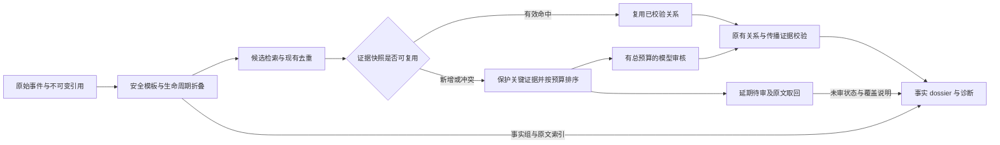

# AgenticSRE 告警事件压缩与聚合：论文调研及方法采用建议

检索截止：2026-10-16。面向技术评审及 AgenticSRE 研发。重点覆盖 2023—2026 年，补充必要经典。本报告基于一手论文、正式会议/期刊记录、作者材料及项目源码与远程测试；公开论文效果、内部测试结果、拟采用设计分别标明。研究阶段没有执行论文复现或生产部署；其后仅首阶段审核预算、部分结果和关键事实引用能力获准上线，详见[发布记录](../validation/alert-review-release-20261016.md)。其余方案仍待验证。

**建议采用，但应优先采用分层处理、审核复用和证据选择机制。现有系统的模板归并、生命周期和证据校验方向成立，下一步应解决“哪些候选值得再次调用模型”和“有限上下文怎样保留诊断证据”。暂不把跨类型语义相似升级为自动同源合并，也不以完整图神经网络替换现有链路。**

## 1. 决策依据与可信程度

| 判断 | 依据与可信程度 | 对项目的决定 | 改变判断的条件 |
|---|---|---|---|
| 分层处理比全部候选交给 LLM 更值得优先验证 | COLA 直接研究告警选择性升级；SCOPE、LILAC 在日志解析中采用轻量路径。机制证据高，迁移收益中等 | 首先补任务预算、证据版本化缓存和升级策略 | 独立回放中路由开销抵消收益，或稀有事件召回下降 |
| 关键证据保留应先于进一步提高压缩率 | SuperAgg 的层级消融；本项目曾发现组内峰值被代表样本遗漏。可信程度高 | 保留极值、状态转换、稀有异常、冲突和原文索引 | 只有固定后端配对评测证明删减无损时才缩小保留集合 |
| 单独换更强语义模型不足以解决全链路成本 | 内部双路召回提高，但候选和负载增加；DiLink 分类分数不等于在线候选预算。可信程度中高 | 多语言召回保留为候选能力，同时控制审核工作量 | 新模型在等预算、独立多语言事故集上全面优于分层基线 |
| 拓扑与传播图适合增强排序和解释 | DiLink、SkyNet 支持结构信息；ProAlert 官方摘要强调路径语义。可信程度中等 | 先作为证据特征；缺边保留 unknown | 完整性验证与独立事故标签足够，才能试验更强自动归组 |
| 验收必须分开衡量模板、候选、归组、证据与 RCA | Loghub-2.0、RCAEval、OpenRCA 的任务和分母不同；可信程度高 | 固定诊断后端，报告质量—覆盖—成本曲线 | 不接受用单一压缩率、文本相似分或解析准确率替代 |

以上是本研究的工程判断。核心原始证据见 [COLA](https://arxiv.org/abs/2403.06485)、[SCOPE](https://arxiv.org/html/2603.27247v1)、[LILAC](https://arxiv.org/html/2310.01796v3)、[SuperAgg](https://nkcs.iops.ai/wp-content/uploads/2024/10/ISSRE24_SuperAgg.pdf)、[DiLink](https://arxiv.org/abs/2403.18639)、[SkyNet](https://ennanzhai.github.io/pub/sigcomm25-skynet.pdf)；内部数据见[多语言检索验证](../validation/alert-multilingual-20261015.md)和[证据保真验证](../validation/alert-fidelity-20261015.md)。

## 2. “压缩”和“聚合”需要拆成六项工作

| 工作 | 输出与允许的动作 | 必须保留的区别 |
|---|---|---|
| 重复投递消除 | 相同来源事件/同次状态变更只计一次处理 | 相同文本可能是再次发生的新故障 |
| 模板解析 | 静态模板、参数列、来源记录 | 同模板不等于同事故；变量可能是唯一根因证据 |
| 生命周期折叠 | 一轮 firing、重复、resolved 的 episode | 恢复后 refiring 是新 episode；迟到恢复不能关闭新一轮 |
| 关联候选检索 | 给出值得审核的告警对或事件集合 | 语义相近、同窗共现不等于应当合并 |
| 事故归组与传播解释 | 有证据支持的成员关系、候选路径 | 两个并发故障不能因一个错误桥接边被吞成一个簇 |
| 诊断证据压缩 | 有限 token 的事实摘要及可取回的原文索引 | 字节压缩、token 减少、诊断无损是三种不同结果 |

Drain/LogShrink 主要帮助模板解析和结构化/存储表示；投递去重另需稳定的来源事件身份与状态约束。COLA、SuperAgg、SkyNet、DiLink 主要研究告警或事件关联；LogBatcher、LLMLingua-2 为输入选择提供可迁移机制。这些任务间的迁移必须另做实验。[Drain](https://pinjiahe.github.io/files/pdf/research/ICWS17.pdf)、[LogShrink](https://arxiv.org/abs/2309.09479)、[LogBatcher](https://arxiv.org/html/2406.06156v2)、[LLMLingua-2](https://aclanthology.org/2024.findings-acl.57/)

## 3. 值得采用的论文机制

### 3.1 COLA：优先采用“只升级不确定候选”的架构

COLA 正式发表于 ICSE-SEIP 2024。它结合历史时空关联与 SOP 知识，把低置信告警对送给 LLM。三个内部数据集的 F1 为 0.908、0.930、0.901，评价按簇展开的告警对计算，不能当作本系统事故召回率。其量化证据来自内部模型和生产数据，完整公开复现条件不足。[原文 §3—4、表 2](https://arxiv.org/pdf/2403.06485)

**可采用的是处理顺序。** 已通过确定性证据检查的重复工作无需再次调用模型；新增、冲突、低覆盖和未知类型进入有预算的审核队列。COLA 图 7 中由标题/影响相似推同根因的提示规则不应照搬。本项目仍需维护“候选关联”“已核验关系”“因果确认”的不同状态。

### 3.2 LILAC、SCOPE、AdaptiveLog：缓存与困难样本路由

LILAC（FSE 2024）先查模板缓存，未命中再调用模型并处理模板冲突。SCOPE（ICPC 2026）用语法优先、语义兜底减少调用；但其表 3 平均调用 41.7 次对 LogBatcher 258.2 次，总 token 却为 98.4K 对 65.8K。AdaptiveLog 已有 TOSEM 正式发表记录，使用验证集中的已确认错误案例和小模型不确定性触发大模型。这些是日志解析/分析证据，并非告警归组验证。[LILAC](https://arxiv.org/html/2310.01796v3)、[SCOPE](https://arxiv.org/html/2603.27247v1)、[AdaptiveLog 原文](https://arxiv.org/pdf/2501.11031)、[正式 DOI](https://doi.org/10.1145/3749840)

**项目应新增的是关联审核结果的有效范围和失效机制。** 当前向量缓存和作业内 checkpoint 已有，不能把它们误称为缺失。拟增加跨扫描的证据快照复用，失效条件包括新 episode、新参数极值、状态/严重性变化、新部署版本、拓扑或 Trace 证据变化、SOP/模型/策略版本变化。只保存经过校验或人工确认的关系结论，不能把 LLM 自报信心作为已校准概率。

SCOPE 作者仓库的 PA/调用次数与论文不同；LILAC、AdaptiveLog 的代码许可本轮未完整确认。近期采取独立实现机制、固定版本验证的方式，不直接复制整套仓库。详见[解析论文核验笔记](../../outputs/alert-literature-20261016/log-compression-papers.md)。

### 3.3 LogBatcher：先实现简单的差异覆盖，再考虑复杂选样

LogBatcher（ASE 2024；本轮读 arXiv v2）把同簇但具有差异的日志组批。表 4 的多样性、随机去重、相似性抽样 MLA 分别为 0.895、0.890、0.831：支持避免重复选相似样本，但不足以证明复杂 DPP 对简单基线有很大优势。该论文的批大小约束不等于本项目需要的真实 token 预算。[原文 §4、表 4](https://arxiv.org/html/2406.06156v2)

**可采用差异覆盖机制，先用确定性贪心基线。** 先保留必需事实，再按新增模板、资源、时间段、参数变化选择代表证据。禁止只保留中心样本或最高频样本。若必需事实已经超出预算，应分块或按需取回原文，显式标注覆盖范围，不能静默丢弃。这个预算设计是本项目建议，尚未验证收益。

### 3.4 SuperAgg、SkyNet：优先折叠重复上报，谨慎跨类型聚合

SuperAgg（ISSRE 2024）提供直接的取舍证据。表 IV 中仅传感器层处理时 A/B 压缩率为 98.88%/98.33%，已标注哨兵保留率均为 100%；加入跨传感器层后，压缩率仅再提高 0.16/0.31 个百分点，哨兵保留率降至 99.18%/95.88%。哨兵是专家选出的 607/558 个样本，不能解释成全部事故准确率。作者保留数据库原始记录。[原文表 II、IV、§VI](https://nkcs.iops.ai/wp-content/uploads/2024/10/ISSRE24_SuperAgg.pdf)

SkyNet（SIGCOMM 2025）统一不同监控来源，去除重复频率的影响，再按网络位置组织事件。其网络场景和 Kubernetes 应用告警有差异，不能移植为“拓扑邻近即同根因”。[原文 §4](https://ennanzhai.github.io/pub/sigcomm25-skynet.pdf)

**本项目应将重复通知折叠为工作项，始终保留状态轨迹和原文。** 新异常、严重性提升和稀有证据直接进入可见队列；短暂抖动不能无条件等待到窗口结束。现有生命周期模块可以承接，不必另造一套事故存储。

### 3.5 DiLink、ProAlert、AlertGuardian：适合中期证据增强

DiLink（WWW Companion 2024，Industry Track）结合事件文本和服务依赖图。其 0.963 的 F1 来自构造、下采样后的事件对分类，不代表原始告警流的精确率或压缩率；缺边实验说明不能把“没有拓扑边”当成确定无关。[原文 §3—6](https://arxiv.org/pdf/2403.18639)

ProAlert（FSE 2025）官方摘要提出历史模式与拓扑语义下的传播路径验证。本轮未取得 ACM 全文，故仅列入后续路线，不引用效果数字。[官方会议页](https://conf.researchr.org/details/fse-2025/fse-2025-research-papers/39/Alert-Summarization-for-Online-Service-Systems-by-Validating-Propagation-Paths-of-Fau)

AlertGuardian（ASE 2025）把轻量图去噪、RAG 摘要和规则改进分开。论文表 III 的 90.5% RCA 指标只在 Dataset A 上用 incident 注释启发式匹配；规则建议总接受率约 32%，也不支持无人审核修改告警规则。**近期可借鉴 SOP 证据接入和人工确认反馈；图训练、噪声节点过滤与规则自动调整暂缓。**[官方会议页](https://conf.researchr.org/details/ase-2025/ase-2025-papers/1/AlertGuardian-Intelligent-Alert-Life-Cycle-Management-for-Large-scale-Cloud-Systems)、[原文 §IV、表 III—IV](https://yuxiaoba.github.io/files/ASE25/AlertGuardian.pdf)

### 3.6 2026 年新工作及不能直接采用的路线

SLS-Bench 是 2026 年 10 月的事故日志摘要预印本，90 个事故报告派生合成日志；评分参考摘要而不读取原始日志，其自身也指出这种限制。可借鉴时间线与诊断摘要评估维度，不能据高分宣称生产证据忠实。[原文](https://arxiv.org/html/2610.16412v1)

OpenRCA 2.0（2026 预印本）把根因命中与传播过程分开评分，值得采用这种验收思想。但论文 500 例与当前公开数据卡 455 例、许可声明存在差异，需固定版本后使用。[论文 v2](https://arxiv.org/html/2606.27154v2)、[数据卡](https://huggingface.co/datasets/anon-ops/ops-lite/blob/main/README.md)

LLMLingua-2（ACL Findings 2024）在中文长文本五类任务的约 5 倍压缩下，综合分为 38.1，完整输入为 42.5；这既不是无损压缩，也不是中文运维告警证据验证。暂不使用 token 删除模型处理错误码、否定词、状态、数值或证据 ID。[正式论文附录 J、表 10](https://aclanthology.org/2024.findings-acl.57.pdf)

AST 2026 的 *From Logs to Lessons* 以 8 位工程师、5 个汽车软件故障观察摘要辅助诊断，发现部分认知负担增加、挫败感减少。样本小、领域不同，但足以反对“摘要更短必然诊断更快”的假设；应支持用户或诊断器按需取回证据。[作者全文](https://greg4cr.github.io/pdf/26llmlog.pdf)、[正式发表记录](https://research.chalmers.se/publication/553498)

KDD 2014 的关键告警选择研究提供图上覆盖优化思路，但其近似保证依赖论文定义的传播图及目标函数；不能将 `1−1/e` 保证套到本项目任意 token 预算选样器。[原文](https://bzong.github.io/doc/critical-alert-mining.pdf)

## 4. 与现有代码逐项对照

以下为 2026-10-16 工作区候选源码审读，不能理解为生产已经部署。

| 已有能力 | 代码入口 | 这次需要补什么 |
|---|---|---|
| 安全模板、保留成员原文、Drain3 注释 | `alert_compression.compress_alerts`、`alert_semantics.symbolic/annotate_groups` | 保持现有归组边界；LLM 新模板只提议、冲突回退 |
| 生命周期状态与 episode | `alert_lifecycle.AlertLifecycle` | 重复工作索引应引用 episode；在已有水位/重触发回归上扩展事件时间、乱序恢复和多故障回放 |
| 向量缓存、同文本复用、候选对去重 | `alert_embeddings`、`alert_semantics.recall_candidates` | 候选对本来已按无序 ID 对去重；要补的是跨扫描审核复用，不是再加一次去重 |
| ANN 候选池、Top-5、可选 `max_pairs` | `alert_retrieval.neighbor_pools`、`recall_candidates` | 检索数量限制不等于审核预算；所有未审项仍需可见、可取回 |
| 每批 20 对、输出 token 上限、单批超时 | `alert_compression.propose_relations` | 增加总调用、总 token、总 deadline，并按实际输入 token 组批 |
| 异步队列、作业内 checkpoint、重试 | `alert_jobs.AlertJobs.process` | checkpoint 只复用同一作业批次；补跨扫描证据快照和 `deferred_budget` 状态 |
| 拓扑、Trace/变更/指标校验，关系不自动认证因果 | `alert_context`、`build_scag`、`alert_root_candidates` | 用于排序/路由；不能绕过现有证据规则 |
| dossier 首尾/代表样本、原文索引、数值极值 | `CompressionStore.dossier`、`alert_numeric` | 关系审核已有实时指标极值；仍需统一纳入日志文本极值、状态变化与冲突样本 |

这里有一个具体缺口：`propose_relations` 当前对每组取首条样本、文本截到 300 字，再补上下文。匹配有效的 live Prometheus 上下文已经包含最小/最大值，但 dossier 中由日志文本提取的 `log_numeric_summary` 及其极值原文尚未进入这个审核输入；因此 dossier 的峰值保真修复，并不自动保证关系审核模型也看见日志中的峰值。应统一证据选择接口，在不同下游保留同一事实清单；这项结论来自代码审读，尚未新增故障验证。

本轮远程 10,000 组负载返回 49,970 个候选对。按当前每批 20 对，若全部审核且无重试，计算上需要 `ceil(49970/20)=2499` 次调用。**这是根据代码和候选数量推算，未实际执行这些 LLM 调用。**现有硬边界与 Top-K 避免了全量两两比较，却仍可能留下很大的审核工作量。[源码](../../agents/alert_compression.py)、[队列](../../agents/alert_jobs.py)、[负载记录](../../outputs/alert-multilingual-20261015/load-r2-hybrid-minilm.json)

## 5. 拟采用方案与实施顺序

### 第一阶段：预算与可观测性，先解决有界完成

在作业层记录 `retrieved / reused / admitted / completed / failed / deferred` 数量及分层覆盖。增加 `max_model_calls`、`max_input_tokens`、`max_output_tokens`、总 deadline；每次调用之前预留额度，重试计入同一预算。预算耗尽生成可读的部分结果和明确的待审列表，不能把未审核候选计为无关或成功处理。

事实组、原文索引及覆盖说明不依赖模型审核通过，均可进入 dossier；待审/失败项带明确状态，不能进入已核验关系集合。当前 `AlertJobs.process` 在失败批次出现后会先标 `partial` 并返回，最终扫描结果落盘在其后。因此首阶段还必须改造部分结果落盘与读取地址，验证预算耗尽、模型失败、重启恢复时诊断器确实能读取事实；只增加计数和状态还不够。

预算需要区分一次扫描和持续 episode。每次新扫描都重置全部额度会重新制造重复审核；无限延期也不成立，需要队列年龄和保留期政策。最高严重性、新状态、稀有类型和唯一证据设保护配额；如果所有必需项仍超过预算，应分块并明确未覆盖范围，而不是突破总上限。

### 第二阶段：审核复用与差异证据选择

缓存键至少包括租户/集群/命名空间、实体身份、episode、模板和规则版本、状态、关键参数摘要、观测证据内容哈希、模型/提示/SOP/判定策略版本。键中不能只放相似文本或易碰撞的简称。对无方向关系可以规范化成员顺序；传播方向必须单独保存并在复用时核对。

首次实现只复用**等价证据快照下的有效结果**，记录创建、绝对 `valid_until`、失效和来源，并以当前时间重新检查证据年龄；相同内容哈希不代表仍未过期。复用后仍走原有证据校验。不默认把不同事故的同模板视作同一事实。可复用范围越窄收益可能越小，应由实测命中率判断。已确认的跨事故案例可作为检索示例，不能当作本次事故结论。

证据选择先构造必需集合 M：实体、来源、原文 ID、时间范围、次数、状态转换、数值及单位、最小/最大值的来源、罕见错误/冲突。对剩余预算采用“新增覆盖 / 实际 token 成本”贪心选择，和首尾、随机去重、异常优先基线比较。M 超预算时按事件/事实分块；完整原文仍可查询。不能宣称此启发式继承某篇论文的最优性保证。

### 第三阶段：校准路由、SOP 和传播结构

有独立标注集后，再学习哪些候选需要 LLM。训练信号应来自经确认的误合并、漏关联和证据不足，不能将余弦分数直接当概率。SOP 按版本和适用服务检索；拓扑边、同一 Trace 中连续失败跨度、部署变化等作为独立证据。缺数据保持 unknown，多故障允许多个根因。

完整 DyAlert/DiLink/GRLIA 图模型、跨类型自动抑制、规则阈值自动修改均暂缓。需要先证明现有轻量基线的瓶颈确实是关系表达能力，而非证据缺失、缓存失效或预算管理。[DyAlert](https://zhendong2050.github.io/res/ASE23.pdf)、[GRLIA](https://zbchern.github.io/papers/ase21.pdf)

## 6. 怎样验证“采用后确实更好”

### 数据与分组

现有手写语义挑战只作开发回归，不能再当独立验收集。以完整 incident/campaign 为切分单位，同一原始事件的翻译、改写、相邻窗口和重复导出必须在同一个 split。分别报告时间留后、服务留出、故障家族留出；中文原生、英文、中英混合和翻译测试分别统计。新数据在远程测试环境生成，注入标签、故障路径和未来恢复记录只供评分器使用。

公开材料的用途各自限定：Loghub-2.0 检查解析和低频模板；RCAEval 检查固定后端根因定位；AIOpsLab 支持交互、故障注入和成本记录；RCABench 补复杂传播；OpenRCA 及 OpenRCA 2.0 作为更大遥测/过程评估补充。它们没有直接提供本项目全部告警成员归属真值，仍需人工或注入记录核验。[Loghub-2.0](https://zbchern.github.io/papers/issta24.pdf)、[RCAEval](https://arxiv.org/html/2412.17015v4)、[AIOpsLab](https://proceedings.mlsys.org/paper_files/paper/2025/file/d1f9e4a9f109b6e8b75ed362736f22ec-Paper-Conference.pdf)、[RCABench](https://operationspai.github.io/revisiting-rca-evaluation/)

代码许可和数据许可分别登记：RCAEval 代码 MIT、所核 Zenodo 数据 CC BY 4.0；OpenRCA 代码 MIT、论文所述遥测 CC BY-NC 4.0；Loghub-2.0 为研究/学术使用条款。采用前固定归档与版本，不能由代码许可证推断数据可用于客户商用。来源及其他许可缺口见[基准核验笔记](../../outputs/alert-literature-20261016/evaluation-papers.md)。

### 消融实验和度量

固定同一诊断后端、模型快照与信息时点，分步比较 B0 原始检索、B1 现有安全压缩、B2 多语言候选、B3 预算路由、B4 审核缓存、B5 差异证据选择；不能一次叠加全部方法后只报总提升。对输入资源同时设等 token/工具预算轨道与完整原文参考轨道。新实验配置见[实验规格](../../outputs/alert-literature-20261016/adoption-experiments.json)，**该规格尚未执行**。

| 验收维度 | 必报结果 | 失败处理 |
|---|---|---|
| 候选 | Recall@K、每事件候选数、各语言/稀有类型覆盖 | 缩减工作量不能静默丢正例 |
| 归组 | pair P/R/F1、误合并/漏合并、最终簇污染、拒判/覆盖率 | 不能只评候选子集；错误桥接须在最终成员上计错 |
| 保真 | 分报原文可回查率、关键事实实际进入上下文的覆盖率，以及峰值/单位/错误码/否定/状态保留 | 原文存在却从未进入诊断上下文，不能计作上下文保真成功 |
| 下游诊断 | 固定后端 AC@1 或多根因集合 EM、证据支持比例 | 诊断损失须按事件配对和尾部分层暴露 |
| 成本 | 真实输入/输出 token、全部调用/重试、p50/p95、RSS、吞吐 | 冷热缓存分开；超时和延期计入，不能删掉困难案例 |
| 运行时边界 | 跨作用域误合并、episode 错位、过期缓存复用 | 作为确定性不变量，发现一例即定位修复 |

必须覆盖 timeout 同文不同根因、同故障异文多症状、独立并发故障、迟到 resolved、再次 firing、跨租户同名资源、峰值藏于组中间、一次性稀有告警、拓扑缺边和中文否定/错误码近邻。不要把纯离线日志叠加当作真实并发传播实验。

质量和成本提升数值目前未知。建议先要求关键证据不退化、隔离与生命周期不变量通过，再根据业务误合并代价冻结非劣界限和成本目标。报告按 incident/campaign 聚类的置信区间；`0/12` 手写无关对照未召回，不构成生产零误报证明。

## 7. 现有内部证据与采用边界

远程候选 r2 已完成 1,129 项回归测试。语义手写挑战的共同作用域命中由旧模型 3/8 到双路 7/8；另一隔离挑战由 10/18 到 15/18。共同作用域候选由 34 增至 45，说明召回收益同时增加审核负担。未对这些候选完成真实 LLM 关系准确率验证。

2 CPU/4 GiB 限额下，线程修复后的双路 1,024 种文本首次负载为 59.179 秒、缓存后 3.817 秒；10,000 组高重复负载仍约 40 秒、约为单路两倍，峰值 RSS 约 1.79 百万 KiB。这里首次负载的模型已被前置阶段加载，不能称完整冷启动。这些测量说明预算和重复工作是下一阶段需要验证的方向，不能证明某篇论文已经在本项目奏效。[完整实验记录与镜像/哈希](../validation/alert-multilingual-20261015.md)

此前证据包对照能恢复藏在组中的 9,000 ms 峰值，但只有少量受控证据读取调用，不能当完整 RCA 质量结论。[保真验证](../validation/alert-fidelity-20261015.md)

截至 2026-10-16 00:05（北京时间）的归档核验，生产仍为原镜像；此次研究没有新增生产行为、提交或推送。下一步最小可交付项是**带可读部分结果的任务总预算、可失效的审核结果复用、统一的关键证据选择接口，以及对应远程配对回放**。完成这些后，再决定是否投入完整图模型。

## 8. 证据链与未解决问题

研究包包含[任务契约](../../outputs/alert-literature-20261016/research-contract.md)、[告警关联八篇核验](../../outputs/alert-literature-20261016/correlation-papers.md)、[日志解析与压缩八篇核验](../../outputs/alert-literature-20261016/log-compression-papers.md)、[六组基准核验](../../outputs/alert-literature-20261016/evaluation-papers.md)、[综合来源与判断登记](../../outputs/alert-literature-20261016/source-register.md)。检索词、排除理由、阅读版本、表格分母与下载来源保留在这些文件中。

合计登记 25 项论文/基准材料，24 份全文 PDF 已在 snail 通过 `pdfinfo`、`pdftotext` 复核并下载到[本地论文目录](../../doc/downloaded_papers/alert-literature-20261016/papers/)；ProAlert 保留摘要级证据标记。[远程验证与 SHA256 清单](../../outputs/alert-literature-20261016/pdf-validation.json)

独立审查提出的事实输出路径、实时指标与日志极值区别、解析论文任务归属三项问题均已修正，详见[审查记录](../../outputs/alert-literature-20261016/review.md)及[处理与 QA](../../outputs/alert-literature-20261016/qa.md)。

主要缺口是中文生产事故标签、跨扫描重复审核的真实占比、关键证据集合的覆盖性，以及未取得的 ProAlert 全文。最脆弱假设是“公开 RCA 真值足以标出哪些告警属于同一事故”；实际上通常不足，需额外 membership 标注。若真实数据表明重复工作很少或缓存失效非常频繁，先实施预算可观测性和证据选择，降低缓存项目优先级。若双路模型在独立等预算测试上没有改善诊断，则不切换生产默认。

## 9. 实施跟进（2026-10-16）

后续已在隔离候选 `agenticsre:alert-review-budget-20261016-r2` 实现作业审核预算、失败或延期时的可读部分结果，以及日志数值极值和原文 ID 进入审核提示。预算使用序列化输入 UTF-8 字节和输出 token 预留，尚非本报告目标中的供应商实际输入 token 计量；同一作业恢复继承预算和 checkpoint，跨扫描审核缓存尚未实现。远程全量回归 1,164 项通过，另完成 Chromium 组件流程验证。

合成对照中，55 对候选在旧版调用 3 次全部审核；候选版遵守 1 次调用上限，审核 20 对、明确延期 35 对，双方保留全部 56 条原始告警。这证明资源限制和事实读取路径生效，不构成等质量成本收益或真实 RCA 质量证明。第 5—6 节中其余缓存、路由及配对回放仍为拟实施方案。详情和证据见[预算与部分结果验证报告](../validation/alert-review-budget-20261016.md)。

用户后续授权后，首阶段能力已在 2026-10-16 上线。生产继续使用原 `all-MiniLM-L6-v2` 检索配置，多语言双路模型保持候选能力；正式后端的零模型预算合成导入和 Chromium 页面检查通过。详见[上线记录](../validation/alert-review-release-20261016.md)。
