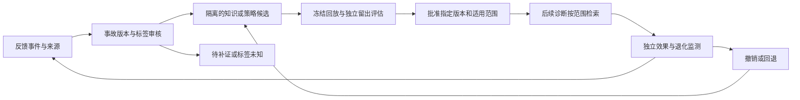

# 反馈与记忆：准确性、有效性及下一步设计

2026-10-22，代码基线 `530e0cc`，运行时源码 `afa9dd9`。本轮为静态调用链和官方资料核查，没有连接生产、运行应用测试或修改运行代码。文中的可触发路径不代表线上已经发生相应错误；建议的契约和验收尚未实现。本专题补充[同类产品能力调研](product-capability-roadmap-20261022.md)。

后续首个实施切片已修复部分标签/审核准入、重复消费和原版本投票，详见[当前反馈契约](../feedback-contract.md)。下文审计结论保留其 `530e0cc` 基线含义；尚未完成的记忆范围、撤销、候选晋升及收益证明不因此视为完成。

第二个实施切片已为诊断消费者增加范围/时间硬过滤与检索前准入，覆盖和限制见[记忆准入契约](../memory-admission.md)。这不追溯改写下文基线审计，也不表示候选晋升、撤销传播或独立收益验证已经完成。

第三切片已补[候选隔离与人工版本审核](../memory-candidates.md)，并阻断原始反馈和自动事例旁路。人工启用与独立评测晋升仍明确区分；本报告的基线审计不因此改写为当前事实。

**当前结论是：反馈和记忆的基本回路已经接通，但还不能认定回路准确、收益有效。** 准确性关心标签是否可信、是否反馈给原事故及原知识版本、是否被重复消费、错误能否撤回；有效性关心更新后对独立的未来事故是否更好。存入更多规则、召回更多经验、Judge 分数提高或规则生成成功都不能单独证明这两点。

## 一、已有基础与本轮发现

多智能体 `run_rca` 路径已有严格引用、调查缺口和模型完整性门禁，其自动学习与恢复都受这些门禁约束；诊断正确性与恢复成功分开统计。Agent+Skill 有自身的阶段、权限与置信度策略，不能据此声称已具备等价的独立 Judge 或自适应多轮 Skill 重规划。规则可做内容 revision/CAS 编辑并保留历史，自愈 recipe 的草案、审批和恢复较完整，Skill 有绑定草案哈希的发布门禁。历史读取已有默认 5 秒预算、单飞、迟到结果不回填、失败与空结果区分、空库不发嵌入查询等保证。现有冻结回放、消融和成对统计也值得复用。

这些机制解决了部分工程可靠性，不能自动认证学习标签。以下是实际代码路径和主要缺口，均可由代码复核；尚未专门做本轮远端故障复现。

| 优先问题 | 代码事实与触发条件 | 对闭环的影响 |
| --- | --- | --- |
| 标签类型未在知识更新前校验 | [ContextLearner](../../memory/context_learner.py) `:146` 直接读取模型 `correct`，缺失默认 False；[ExpertFeedback](../../memory/expert_feedback.py) `:134` 使用 `bool(correct)` 投票 | 模型返回字符串 `"false"` 时会成为正票。准确率统计后来虽过滤非 bool，但无法撤销此前票数；缺失标签也不应自动认作错误 |
| 待补证也能触发学习 | [HumanReview](../../memory/human_review.py) `:115` 将 needs_more_evidence 保持 pending，`:118` 却只看专家文本是否非空；[ExpertFeedback](../../memory/expert_feedback.py) `:112` 无 trace 时仍用占位内容监督学习 | 未完成审核或未匹配原事故也可能生成知识；[FaultContextStore](../../memory/fault_context_store.py) `:144` 将新规则默认 active。纯 approve 无文本不会学习，reject 加经确认纠正答案也可能合理，不能一概归类 |
| 重复反馈和规则版本没有统一消费身份 | [ExpertFeedback](../../memory/expert_feedback.py) `:78` 每次新建随机 ID，`:149` 追加记录；[HumanReview](../../memory/human_review.py) `:106` 未以既有 closed 状态拒绝重复消费；[规则投票](../../memory/fault_context_store.py) `:214` 按 ID 更新当前规则 | 同一反馈重试可重复计票/增加样本；原事故后规则已编辑但 ID 不变，迟到反馈可能更新新内容。内容去重不等于事件幂等 |
| 召回不等于贡献，统计名易误导 | [ContextBuilder](../../memory/context_builder.py) `:94` 的 used_rule_ids 实为进入上下文的历史规则；[ExpertFeedback](../../memory/expert_feedback.py) `:133` 对它们给整案同票；[EvolutionTracker](../../memory/evolution_tracker.py) `:144` 召回与使用数来自同一列表 | 无关规则可能跟随整案成功获益，正确规则可能跟随整案失败受罚。反馈 success_rate 是产生规则的反馈比例，不是诊断准确率或学习有效率 |
| 模型判断可能回流为活跃经验 | [RCAEngine](../../orchestrator/rca_engine.py) `:523/:532/:562` 可共用同一 llm 做候选、审核和提取；`:1314` 学习早于 `:1343` 恢复；监督 correct 也由模型比较专家文本产生 | 独立角色不是独立真值。已有引用和最终门禁降低风险，但不能以模型通过循环证明其结论正确；目前不能把此类标签无条件称人工确认真值 |

更详细的静态路径、反证和行号见本轮内部底稿 `outputs/product-research-20261022/feedback-loop-audit.md`。例如，无 trace 时不会给原规则投票，因为列表为空；问题是仍能生成新知识，不能夸大为每个缺失都触发全部后果。

## 二、从同类产品可借鉴什么

Datadog 文档描述反馈形成可查看、删除并在相似上下文检索的 memories。其工程文章把反馈生成的标签视为需整理验证的候选，使用隔离的历史环境和无关背景噪声检查版本变化；并未为我们公开承诺严格留出切分、自动晋升阈值或完整撤销链。[知识源](https://docs.datadoghq.com/bits_ai/bits_investigation/knowledge_sources.md)、[评测工程文章](https://www.datadoghq.com/blog/engineering/bits-ai-eval-platform/)

Dynatrace Assist 明确反馈不用于自动训练模型；AWS 则将生产经验连接到预防改进事项和发布前评审。这说明应在产品中分别呈现“反馈已保存、知识候选已生成、候选已验证、已用于后续诊断、已观察到收益”，而不是统一显示“学习成功”。[Dynatrace Assist](https://docs.dynatrace.com/docs/dynatrace-intelligence/agentic-and-generative-ai/chat-with-dynatrace-assist)、[AWS 生产反馈](https://docs.aws.amazon.com/devopsagent/latest/userguide/working-with-devops-agent-production-operations-index.html)

下述闭环是本项目拟采用的工程要求，不是上述厂商已经公开保证全部具备的功能。

## 三、反馈事件需要怎样定义

反馈首先是一条有来源、可修订的记录。拟增加不可变 `feedback_event_id`、幂等键、actor/来源、事故 session/run、诊断 revision/哈希、证据快照、反馈种类、标签、说明、时间以及 supersedes/retraction。类型至少分诊断正确性、根因对象正确性、取证质量、动作结果、业务恢复、用户偏好。人工确认、模型比较和工具观测各有独立字段。

correctness 只接受严格 bool 或显式 unknown；字符串和缺失字段不能走 Python 真值转换。needs_more_evidence、无 trace、版本不匹配、来源不可确认时只保存待核验反馈。拒绝原诊断并提交已确认纠正答案可以产生负例候选，但不能因为文本存在就直接成为 active 规则。自动提取也先进入候选区，人工批准诊断不等同于批准所有派生规则。

消费记录绑定事件 ID、原规则 ID 和内容 revision。分别记录 retrieved、rendered、cited、expert_useful 和经对照测得的 benefit；无法判断贡献时保留 exposure，不给所有召回项集体 correctness 票。旧规则的迟到反馈不能自动作用于编辑后的新内容。撤销以追加事件和派生依赖失效处理，保留原历史，不靠删除一条记录就声称已消除全部影响。

恢复成功只能作为其对应动作、对象与环境下的观测结果。无需强迫每次诊断执行变更以得到真值，也不能把“重启后暂时好转”自动当作最终根因标签。现有恢复统计和诊断统计分离应继续保留。

## 四、记忆应当分层，而非统一当作事实

当前已经有 Chroma/JSON 故障与规则、trace、专家反馈、domain hints、事故内观测、Skill 与 recipe；问题主要是可信复用边界及生命周期衔接。建议在现有存储上增加统一契约，暂不以更换向量库或图数据库为目标。

本轮确认的记忆问题有明确路径，并非只提出理想架构：

| 当前路径 | 静态事实 | 应补的契约 |
| --- | --- | --- |
| 多智能体历史召回 | [规则/事故查询](../../memory/fault_context_store.py) `:175/:419` 没有 cluster/namespace 的硬过滤参数；[RCA 使用历史](../../orchestrator/rca_engine.py) `:558` 直接接收结果 | 先按适用范围筛选，再检索；通用经验须显式验证其可迁移范围 |
| Skill 历史召回 | [上下文构造](../../web_app/app.py) `:8987/:9002` 在全局召回后按 cluster 过滤，规则接受无 scope，事故严格同 cluster；recent_runs 另有 cluster/namespace 检查 | 不能概括成全部路径都无隔离，但后过滤可能丢掉合格候选，无 scope 不等于已审核的通用规则 |
| 自动事例写入 | [事故存档](../../memory/context_learner.py) `:169` 保存描述、根因、置信度、假设和摘要，缺结构化 cluster、namespace、UID、run 与版本 | 将原事故 ID 和证据身份保存到完整存档；避免写入时丢失而查询时无法核验 |
| 专家反馈与治理状态 | [近期反馈](../../memory/context_builder.py) `:164` 取全局最近条目；[规则治理](../../memory/fault_context_store.py) `:269` 报告 stale/conflict，普通召回只检查 active | 来源、状态、适用性和时间要进入消费契约；过时/冲突提醒不等于已阻止其参与诊断 |
| 撤销与可见性 | [知识删除](../../web_app/app.py) `:13354/:13403` 的 Chroma 异常可被吞后仍报 ok；JSON/feedback 对象存在初始化后的内存视图 | 删除应以可核验结果反馈，派生物另行失效；跨实例旧视图与全文件写入需受控并发验证，不能据静态路径宣称线上已丢数据 |

完整来源/消费者范围矩阵和存储一致性边界见内部底稿 `outputs/product-research-20261022/memory-code-audit.md`。每次调查的 detached 快照是已有事实，不应误称现有系统有一套长期检索结果缓存；缓存失效是新增扩展需要维持的契约，现有实例缓存和未完成调查也需要明确撤销可见性。

| 记忆类型 | 应保存的内容 | 使用约束 |
| --- | --- | --- |
| 调查工作记忆 | 本次假设、对象、追加观测、工具结果、预算与当前缺口 | 绑定 run/revision 和对象实例；压缩摘要不能替代原始观测或将 unknown 改成否定 |
| 事故事例记忆 | 原事故、当时证据、诊断及其确认来源、处置和业务恢复结果 | 按环境、服务、时间和结论状态检索；过去恢复不代表现在同名 Pod 故障相同 |
| 诊断规则记忆 | 条件、可证伪机制、适用范围、反例、来源及知识版本 | 候选与验证过的规则分开；明确 cluster/namespace/服务/软件版本或经审核的通用范围 |
| 操作过程记忆 | 已版本化 Skill、runbook、recipe、前置条件与后置验证 | 复用已有草案、审批和恢复；记忆被检索不授予工具或变更权限 |
| 组织与偏好记忆 | 责任团队、术语、沟通偏好和明确业务政策 | 偏好不生成根因事实；负责人和政策有有效期与来源，不能按旧事故猜测现任 owner |

工作记忆属于“这次观察到了什么”，事例记忆属于“那次发生过什么”，规则属于“什么条件下可能如此”，过程属于“被批准怎样检查或处置”。存储媒介可以共享，实现语义必须分开。

### 召回必须先满足硬条件

时间与分层记忆可借鉴两组补充来源。Graphiti 的事实边区分 valid_at/invalid_at 与 created_at/expired_at，并保存 episode 来源；但其时间抽取与部分冲突候选判定依赖 LLM，所以字段完整不等于事实已认证。[Graphiti 数据模型](https://github.com/getzep/graphiti/blob/main/graphiti_core/edges.py)、[冲突处理实现](https://github.com/getzep/graphiti/blob/main/graphiti_core/utils/maintenance/edge_operations.py) 本轮读取的是滚动 main，尚未固定源码提交，实施复用前必须固定版本。

Letta 的 legacy V1 SDK 文档将常驻上下文 blocks 与按需检索 archival 分开，可借鉴为不同的上下文预算；当前概念页另外描述 MemFS，不能混称其所有产品使用同一实现。[blocks](https://docs.letta.com/v1-sdk/memory/memory-blocks)、[archival](https://docs.letta.com/v1-sdk/memory/archival-memory)、[当前概念与版本边界](https://docs.letta.com/concepts/stateful-agents) 这些表示与读取机制不自动保证作用域授权、事实正确或撤销传播，本项目仍需自己的契约和验收。

建议次序为：主体可访问范围 → cluster/namespace/服务等适用性 → 知识状态和时间有效性 → 语义/词法检索 → 冲突检查及重排 → 带来源的预算内上下文。不能先全局 top-k 再把被越界项目剔除就认为召回完整，因为合格项目可能从未进入 top-k。

无 scope 的旧知识不自动解释为跨集群通用；只有经过审核且显式标为通用的规则才跨范围复用。通用规则可以适用于新 UID，但旧对象的状态事实不能因为名称相同自动迁移到新实例。用户提供的文档、日志和反馈属于输入材料，不是新增工具权限或可执行系统指令。

每个可复用条目拟保留：来源对象/证据/反馈 ID、内容 hash 与版本、状态、作用域、recorded/observed 时间、已知的 valid_from/valid_to、复核者及期限、取代/撤销关系。有效时间未知时保留未知，不根据写入时间补造。历史事实本身可以继续为真，只是未必适合当前环境；过期策略不应一律抹去事故史。

冲突条目不能简单以较新、分数更高或投票更多决定真值。先检查是否对象实例、服务版本、时间区间和适用条件不同；仍冲突则同时保留来源并降级为待审，停止把两者作为已确认依据。撤销规则后，派生规则、后续检索缓存和对应投票资格应失效或待审；已经冻结的历史回放保留当时版本，同时标明后来撤销。

### 检索预算不能因“记忆增强”失去约束

保留现有历史读取的有界预算、单飞和迟到结果隔离。新增混合检索、重排或图遍历必须共用总时间/token/候选数预算，不能每层重新申请完整预算。检索超时或不具备权限时仍允许无记忆的保守诊断，明确缺口；不能无界下载嵌入模型或把缺数据变成“没有历史问题”。

## 五、怎样证明闭环有效

复用已有冻结回放和统计实现，增加实验合同：固定父知识版本、反馈批次、审核版本和候选策略；按事故实体/故障实例、时间及服务划分学习与留出集；同一事故重试、重复窗口和改写告警不能跨集合伪装独立样本。未来才得到的反馈或处置后证据不出现在当时的诊断输入中。没有证据认定当前 benchmark 已泄漏；这是新增反馈实验必须维持的边界。

做三个配对分组：A 关闭历史记忆，B 使用冻结旧记忆，C 使用经过该批反馈修订的候选记忆。模型、工具、时间与调用预算保持一致。B 对 A 衡量历史记忆本身是否有用，C 对 B 衡量该批反馈是否带来增益；不能用 C 对 A 的差异归功于这批学习。

先验证机制不走错，再衡量效果是否改善：

| 维度 | 指标与判定 |
| --- | --- |
| 反馈正确消费 | 非 bool/unknown 不计 correctness；待补证/无原事故/版本失配不晋升；重复事件只消费一次；修订和撤销可追踪 |
| 记忆可信复用 | 越域或无权条目不得进入上下文；错误、过时和冲突知识的注入情况；旧 UID 事实误迁移；撤销传播及缓存失效 |
| 诊断收益 | 留出事故的正确对象/机制、错误确认与排除、弃答、证据引用有效性；按故障族和环境分别报告，不只给总均分 |
| 效率与代价 | 实际工具/模型次数、token/费用、端到端时延、记忆检索 P95 与超时率；已有故障导致无法取证时另列，不删失败样本 |
| 防复发收益 | 实施前后同口径观察窗与曝光量、真实实施证据及是否同一机制复发；仅“观察期无告警”不证明措施有效 |

利用现有 Wilson、McNemar 和配对 bootstrap 报告分母、配对差异与不确定性。样本不足时结论应是证据不足；显著性不代替效果量、安全约束和样本独立性。晋升阈值与非退化边界应在评测前冻结，不能看到结果后调阈值宣布获胜。

## 六、最先应补的验收用例

以下是待实施的验收合同，不是本轮已通过的测试：

1. `correct=false` 正常给负标签；`correct="false"`、缺失、数值等非法形式不计票、不生成活跃知识。
2. needs_more_evidence 加专家文本、无 trace、过期诊断 revision 都只生成待核验记录；明确确认的纠正答案可生成隔离的负例候选。
3. 同一反馈重复、并发重试及关闭审核后的重放不重复学习、计票或增加独立样本分母。
4. 某条规则编辑后，原版本迟到反馈只关联原版本；撤销后新诊断不能取到其未失效的派生规则或缓存复本。
5. 跨集群、跨 namespace、同名不同 UID、旧软件版本和过期规则都不以相似度覆盖硬约束；明确审核的通用规则仍可按适用条件复用。
6. 同时存在一条有用、一条无关和一条矛盾规则时，不因整案成功全部加分；没有实际贡献证据就只记展示/引用。
7. C 组只记住反馈题、但独立事故没有改善或某关键故障族退化时拒绝晋升；不把规则数、学习 success_rate 或同源 Judge 自评分作为替代收益。

下一步先修标签/审核准入和幂等，再补事故与知识版本绑定、召回作用域及撤销链，最后把反馈批次接入现有评测晋升。当前 1867 项历史回归和最近生产上线验证不能证明这些新增合同已经成立。模型服务最近 HTTP402 尚无恢复成功证据，依赖真实模型的收益实验须单独恢复和验收；本轮不重写已有失败样本。

## 七、证据强度与替代解释

代码路径与显式条件为高置信事实，缺少统一消费/撤销闭环的判断为中高置信，限于已读路径，不代表外部网关或未连接实验不存在。模型比较不必然错误、自动学习可能有收益、专家反馈可能很可靠，均是应保留的替代解释；但这三点不能消除可触发的类型、状态、重复和版本问题。

最脆弱的效果假设是：可获得足够独立、覆盖真实噪声和失败路径的已核验事故。若达不到，应只上线可验证的准确消费与范围治理，保持学习候选隔离，收益标为未证实；不靠合成样本或模型打分填补生产真值。若严格对照显示增加记忆使错误确认或成本恶化，则缩小或关闭该类记忆，而非继续扩大召回。
