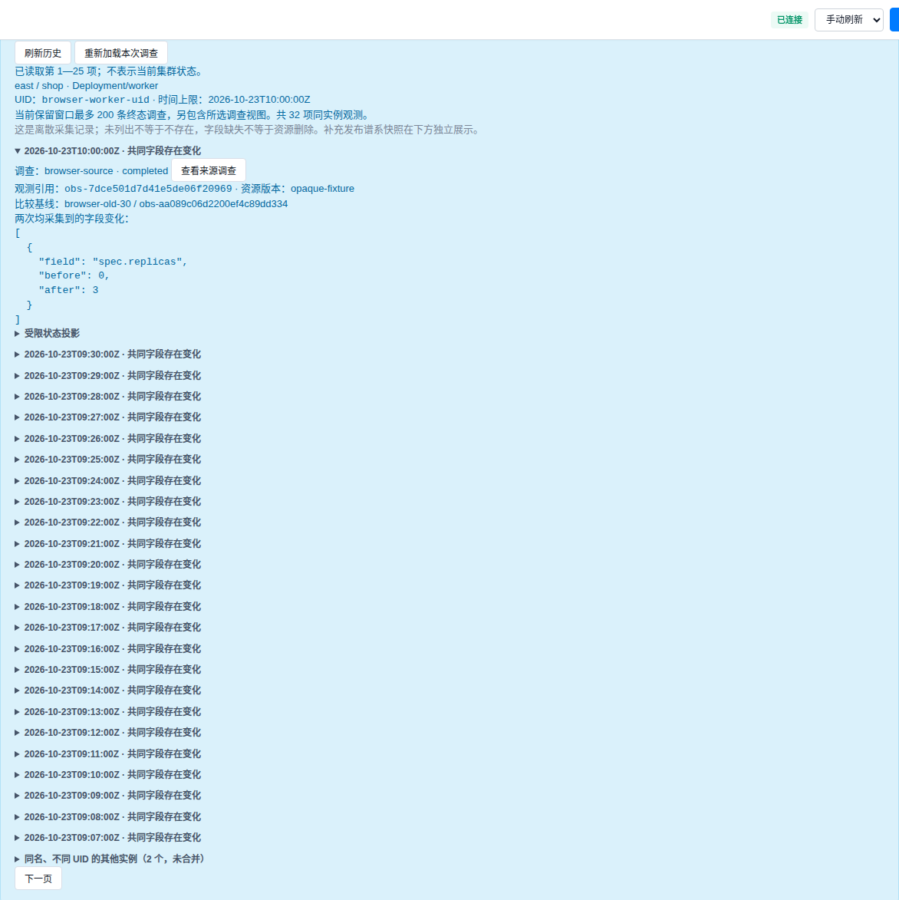
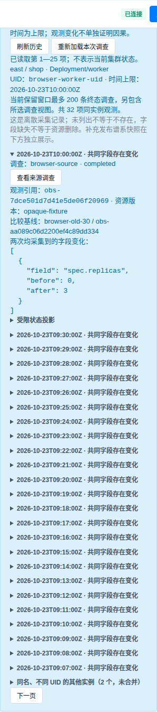

# 跨调查对象观测历史验收

验收日期：2026-10-26。对象详情新增“跨调查历史”，按同一集群、namespace、kind、名称和 UID 汇集当前保留调查中的观测。不同 UID 的同名重建实例单独展示；采集缺口、字段可用性变化与实际共同字段变化分开。具体 API、预算和保留窗口见 [运维 Ontology](../operational-ontology.md#跨调查对象观测历史)。

本轮所有应用测试、镜像构建和浏览器执行均在远程完成。候选以已发布源码树 `6534332dc231b5bba32f78874d964dc8c7205fc5` 为基线，叠加历史模块、API、前端、测试与说明文档，最终发布候选共 828 个文件；不是开发工作目录全部未提交修改的混合验收。最终候选复验包含 README 和公开验收材料；测试后仅更新说明与验收收据，运行时与测试文件未改变。

| 验证 | 结果 | 原始记录 |
|---|---|---|
| 历史专项 | 48 passed，5 项现有弃用警告 | [日志](evidence/ontology-history-20261026/packaged-targeted.txt) |
| 全量回归 | 2108 passed，40 项现有弃用警告 | [日志](evidence/ontology-history-20261026/packaged-full.txt) |
| 执行环境与源码 | 禁网容器；实际模块来自冻结源码；JavaScript 语法及前后源码哈希检查通过 | [收据](evidence/ontology-history-20261026/packaged-verification.json) |
| 应用复制层镜像 | 复用已有依赖，按实际 COPY 指令构建；无源码挂载时完整 Web 应用导入与新路由检查通过 | [收据](evidence/ontology-history-20261026/packaging-verification.json) |
| HTTP/浏览器 | 对象行入口、同 UID 历史、实例分离、恶意文本转义、分页、503/409 页面保留、迟到响应隔离与来源跳转通过 | [收据](evidence/ontology-history-20261026/browser-verification.json) |
| 已保存真实观测回放 | 三条同 UID 观测、两次 selector 变化；已有后端数量 1→0→1 | [收据](evidence/ontology-history-20261026/replay-verification.json) |

新增专项还覆盖无有效采集时间、ownerReference 占位、历史上下文、相同时间顺序未知、partial/失败调查、旧审核节选、未确认工具结果、非 JSON 输出、非法字段、超预算、并发、分页版本与重启保留范围。来源调查身份绑定与范围规范化在修复前分别复现四项、两项失败，最终均通过。独立审查还发现不同容器共用简化信号比较基线的问题；新增五例在旧代码上得到四项失败、一个通过，修复后按容器类别和名称隔离基线，缺少身份时不可比较。修复前结果见 [日志](evidence/ontology-history-20261026/container-binding-pre-fix.txt)。最终 48 项专项包含这些用例。

运行时和测试的精确内容标识见 [SHA-256 清单](evidence/ontology-history-20261026/runtime-source-hashes.json)。

浏览器使用最终应用镜像和合成调查，通过真实 HTTP/页面交互执行；不是实际故障诊断。页面异常、模型调用与业务写入均为零。桌面与移动历史面板检查通过，无面板横向溢出：

真实观测回放读取此前集群已保存的三份 Service 观测，装入合成调查，由新模块生成历史；没有新采集、故障注入或模型调用。原 selector 实验没有满足业务影响验收，`business_impact_verified=false`、`status=failed_acceptance` 保持原值，不能升级为已证实正确的诊断记忆。

本轮结果验证历史读取、差异与页面契约，不证明模型诊断准确率、真实业务故障注入有效性、长期记忆收益或反馈闭环收益。历史接口不调用模型、Kubernetes、动作或学习写入。记录保留不是长期 CMDB，来源跳转不是不可变存档，变化不是故障因果证明。应用复制层构建不代替从头重建依赖；本次没有替换生产服务。

发布复验的移动宽度检查首次命中原有 350 毫秒布局过渡动画；诊断记录显示面板宽度由 198 过渡至 298 像素，稳定后无面板溢出。验证脚本改为等待布局动画结束后执行原断言，最终浏览器流程通过，应用布局代码未改动。
